# Activity Diagram

This skill follows the notation of the GeeksforGeeks article "Activity Diagrams - Unified Modeling Language (UML)". It adds route coverage rules so that the diagram shows every route.

## Workflow

1. **Find the task type.** The user wants one of these:
   - An explanation of the diagram.
   - A new diagram (as diagram code).
   - A document, guide, or procedure about the diagram.
   - A review of an existing diagram.
2. **Get the inputs.** Use the **Inputs** list in this skill. If the user gave enough data, continue. If data is missing, state your assumptions in one line, or ask one question. Do not ask more than one.
3. **Find all routes.** Use the **Route coverage** section. List the main route, the alternative routes, the error routes, and the loops before you draw.
4. **Write the output.** Follow the STE writing rules. Use the output format for the task type.
5. **Check the output.** Do the final check at the end of this file.
6. **Check the fit.** If another diagram fits the need better, say so in one sentence. Related diagrams: Sequence Diagram (for messages in time order), State Machine Diagram (for the life cycle of one entity), Data Flow Diagram (for the movement of data).

## Output formats

**Explanation (chat).** Give the Purpose in one or two sentences. Then give the part that the user asked for (inputs, symbols, procedure, rules, or routes). Do not copy the whole section if the user asked a narrow question.

**New diagram.** Give the diagram as code in a fenced block. Then give the route list. Then add a short STE note: what the diagram shows and which rules you applied. Code format for this diagram: Mermaid `flowchart` (use subgraphs for swimlanes), or PlantUML activity diagram.

Use these Mermaid shapes:

| Element | Mermaid shape |
|---|---|
| Initial state | Small circle with a black fill: `S((" ")):::dot` |
| Action | Rounded rectangle: `A(Verb Noun)` |
| Decision node | Diamond: `D{Question?}` |
| Merge | Diamond with no text: `M{" "}` |
| Fork or join | Thin bar with a black fill: `F[" "]:::bar` |
| Time event | Hexagon: `T{{"Time Event: Wait"}}` |
| Final state | Double circle with a black fill: `E(((" "))):::dot` |
| Guard | Text on the arrow: `-->|"[guard]"|` |
| Swimlane | A `subgraph` for each actor |

Add these two class definitions to the code: `classDef dot fill:#000,stroke:#000` and `classDef bar fill:#000,stroke:#000,color:#000`.

> **NOTE:** Mermaid does not draw an hourglass, a solid fork bar, or a filled circle inside a circle. Use the closest shape and add a NOTE that names the difference.

PlantUML supports `start`, `stop`, `if`, `fork`, `repeat`, and swimlanes. Use them for the same elements.

Example:

```mermaid
---
title: "Activity Diagram - Online Order - Payment and Fulfillment"
---
flowchart TD
    classDef dot fill:#000,stroke:#000
    classDef bar fill:#000,stroke:#000,color:#000
    subgraph Customer
        A2(Submit Payment)
    end
    subgraph System
        START((" ")):::dot
        B1(Check Stock)
        D1{Item in stock?}
        B5(Notify Out of Stock)
        M0{" "}
        B2(Authorize Payment)
        D2{Payment approved?}
        B7(Request New Payment)
        F1[" "]:::bar
        B3(Pack Order)
        B4(Send Confirmation)
        J1[" "]:::bar
        END1(((" "))):::dot
        END2(((" "))):::dot
    end
    START --> B1 --> D1
    D1 -->|"[in stock]"| M0
    D1 -->|"[out of stock]"| B5 --> END2
    M0 --> A2 --> B2 --> D2
    D2 -->|"[declined]"| B7 --> M0
    D2 -->|"[approved]"| F1
    F1 --> B3 --> J1
    F1 --> B4 --> J1
    J1 --> END1
```

Route list for the example:

| Route | Type | Path |
|---|---|---|
| R1 | Main | Check Stock, Submit Payment, Authorize Payment, then Pack Order and Send Confirmation in parallel |
| R2 | Alternative | Check Stock, Notify Out of Stock, end |
| R3 | Retry loop | Authorize Payment, Request New Payment, Submit Payment, then R1 or R3 again |

**Document or guide.** Write Markdown. Use the five-part structure: Purpose, Inputs, Symbols, Procedure, Rules. Add the Route coverage section. If the user wants a file, make a `.md` file (or the format that they name).

**Review.** List each problem with the rule that it breaks. Give the fix for each problem. Put the most serious problems first. List each route that the diagram does not show.

## STE writing rules

Apply these rules to all text that you write for this skill. They follow the main ideas of ASD-STE100. You cannot check against the official dictionary, so do not claim full compliance. If the user needs official compliance, tell them to use an STE checker.

**Sentences**
1. Write procedure sentences with 20 words or fewer. Write descriptive sentences with 25 words or fewer.
2. Give one instruction in each sentence.
3. Start each procedure step with a verb in the imperative (for example, "Draw the initial state.").
4. Put a condition at the start of the sentence (for example, "If the object has no name, use `:Class`.").
5. Limit each paragraph to six sentences.
6. Use a vertical list for three or more items.

**Words**
7. Use one word for one meaning. Use the same word for the same thing in all places. Do not use synonyms to make the text "more interesting".
8. Use simple verbs: *use* (not *utilize*), *make sure* (not *ensure*), *start* (not *initiate*), *show* (not *illustrate*).
9. Do not use phrasal verbs or idioms (for example, "set up", "carry out", "rule of thumb"). Use a single verb: *install*, *do*, *guideline*.
10. Use the articles *a*, *an*, and *the*. Do not drop them.
11. Do not use contractions (write "do not", not "don't"). Do not use "e.g." or "i.e." Write "for example" and "that is".
12. Keep noun clusters to three words or fewer. Use *of* or *for* to break a long cluster.
13. Spell out an abbreviation the first time that you use it.

**Grammar**
14. Use the active voice. Do not use the passive voice, unless the actor is not known.
15. Use the simple present tense for facts and rules. Use the imperative for instructions. Use the simple future ("will") only for a result in a later step.
16. Do not use the *-ing* form as a verb. Use it only in a technical name (for example, "Timing Diagram").
17. Use *can* for ability. Use *must* for a rule that you cannot break. Use *should* only for a good practice.

**Safety and notes**
18. Put a WARNING before a step that can cause a serious error or an unsafe design. Put a CAUTION before a step that can cause a small error. Put a NOTE for extra information.
19. Write each WARNING, CAUTION, and NOTE as a short, direct statement.

## General rules for all diagrams

Apply these rules to each diagram that you make or review.

1. Decide the audience before you start. Make the diagram for that audience.
2. Show one level of detail in one diagram. Do not mix high-level and low-level items.
3. Give each element a short, clear name. Use the same name for the same item in all diagrams.
4. Use nouns for things. Use verbs for actions.
5. Use only standard symbols. If you use a non-standard symbol, add a legend.
6. Put a title on each diagram. Show the diagram type and the scope.
7. Do not cross lines if you can avoid it.
8. Limit each diagram to about 7 to 15 main elements. If the diagram has more, split it.
9. Make sure that each element has a reason to be there. Remove all other elements.
10. Ask a second person to review the diagram before release.

---

# Activity Diagram Reference

## Purpose

The Activity Diagram is a behavioral UML diagram. It shows a workflow, a process, or a use case step by step. It shows how control flows from one activity to the next. It shows sequential actions, decisions, loops, parallel actions, and time delays.

Use the Activity Diagram for these tasks:

- Model a workflow or a business process.
- Show actions that occur at the same time.
- Show how a system responds to events over time.
- Make complex decision logic clear.
- Analyze and design the behavior of a system.
- Describe the flow of actions in a use case.

## Activity Diagram and flowchart

An Activity Diagram is like a flowchart, but it can show more. A flowchart shows the step-by-step flow of an algorithm. An Activity Diagram also shows parallel actions, swimlanes, and time events.

| Flowchart | Activity Diagram |
|---|---|
| Shows procedural or algorithm logic | Shows workflows and business processes |
| Uses start, process, and decision symbols | Uses actions, decisions, parallel flows, and transitions |
| Does not show parallel work well | Shows parallel and concurrent actions |
| Is simple | Is more expressive and detailed |

> **NOTE:** This skill makes the Activity Diagram show every route, like a system flowchart. It keeps the UML symbols.

## Inputs

- The start condition of the workflow.
- All the end results of the workflow (success and failure).
- A list of the actions in order.
- Each decision, with the condition for each outcome.
- The actions that occur at the same time.
- The people or systems that do each action (if you use swimlanes).
- The error conditions and the action for each error.
- The loops and the exit condition for each loop.
- The time delays and the time limits (if the workflow has them).

## Symbols

| Symbol | Name | Meaning |
|---|---|---|
| Filled black circle | Initial state | The start of the activity |
| Rectangle with rounded corners | Action (activity state) | One task or operation in the workflow |
| Line with an arrowhead | Control flow (action flow) | The direction and sequence of the flow |
| Diamond with two or more outgoing flows | Decision node | A point where the flow goes one of several ways |
| `[text]` next to a flow | Guard | A condition that must be true to follow the flow |
| Solid bar with one incoming flow and many outgoing flows | Fork | A split into parallel actions |
| Bar with two or more incoming flows and one outgoing flow | Join | A point where parallel actions finish together |
| Diamond with two or more incoming flows and one outgoing flow | Merge | A point where alternative paths combine |
| Row or column | Swimlane | A group of actions for one role or system |
| Hourglass | Time event | A pause for a set period |
| Filled circle inside a circle | Final state | The end of the activity |

## Route coverage

The diagram must show every route from the initial state to a final state. Find the routes before you draw.

**Route types**

- **Main route.** The normal path to success.
- **Alternative route.** A different valid path from a decision.
- **Error route.** A path that starts when an action fails or an input is not valid.
- **Time-out route.** A path that starts when a time limit ends.
- **Loop or retry route.** A path that returns to an earlier action.
- **Parallel route.** A set of paths that start at a fork and end at a join.

**Coverage procedure**

1. List the main route from the initial state to a final state.
2. Find each action that can fail. Add an error route for each one.
3. Find each decision. List all the outcomes. Add an `[else]` guard if the other guards do not cover all cases.
4. Find each wait for an event or a response. Add a time event and a time-out route.
5. Find each action that the user can repeat. Add a loop with an exit guard.
6. Write each route in a route list. Give each route a number and a type.
7. Trace each route in the diagram with your finger, from the initial state to a final state. Add the missing elements.

> **CAUTION:** Do not show only the main route. A diagram without error routes hides the behavior that causes most system faults.

## Procedure

1. Draw the initial state.
2. Draw the first action. Connect it to the initial state with a control flow.
3. Add the next actions in order. Use a control flow to connect each action to the next.
4. Add a decision node where the flow can go in different directions. Write a guard on each outgoing flow.
5. Add a fork where actions occur in parallel. Add a join where they must finish together.
6. Add a merge where two or more alternative paths combine into one path.
7. Add a time event where the workflow must wait for a set period.
8. Add swimlanes if different actors do the actions. Put each action in the correct lane.
9. Add the error routes, the time-out routes, and the loops from the route list.
10. End each route at a final state.
11. Trace each route from the route list. Make sure that the diagram shows it.

## Rules

**Initial and final states**

- Use only one initial state, unless you use a nested activity.
- Make sure that each route ends at a final state.
- Use more than one final state if the workflow has more than one end result.

**Actions and flows**

- Write each action as a verb and a noun (for example, `Check Stock`).
- Make sure that each action has at least one incoming flow and one outgoing flow, unless it is the first action or an action that goes to a final state.
- Use an arrowhead on each control flow to show the direction.
- Write a condition on a flow when the flow is not always followed.

**Decisions, guards, and merges**

- Give each decision node two or more outgoing flows.
- Write each guard in square brackets, next to the outgoing flow.
- Make the guards on a decision exclusive. Cover all cases.
- Use a merge, and not a join, where alternative paths combine.
- Give each merge two or more incoming flows and one outgoing flow.

**Forks and joins**

- Give each fork one incoming flow and two or more outgoing flows.
- Give each join two or more incoming flows and one outgoing flow.
- Use one join for each fork. Match the number of parallel paths.
- Use a fork and a join for actions that occur at the same time. Do not use a decision node for them.

**Loops and time**

- Give each loop an exit guard, so that the loop can end.
- Use a time event for a delay. Add a time-out route if the wait can fail.

**Swimlanes**

- Use a swimlane for each role, person, or system that does actions.
- Put each action in one lane only.

> **WARNING:** Do not use a join where alternative paths combine. The join waits for all incoming flows, and the workflow will stop.

---

## Final check

Do this check before you give the output to the user.

1. Make sure that the diagram has a title and a diagram type.
2. Make sure that all symbols are standard, or that a legend explains them.
3. Make sure that names are clear and consistent.
4. Make sure that the diagram follows the Rules section of this skill.
5. Make sure that the diagram has one initial state and a final state for each end result.
6. Make sure that each decision has guards for all outcomes.
7. Make sure that each fork has a matching join, and each merge combines alternative paths.
8. Make sure that the route list shows the main route, the error routes, the time-out routes, and the loops.
9. Make sure that you can trace each route from the initial state to a final state.
10. Make sure that the level of detail is correct for the audience.
11. Make sure that the text follows the STE writing rules.
12. If you gave diagram code, make sure that the syntax is valid for the tool.