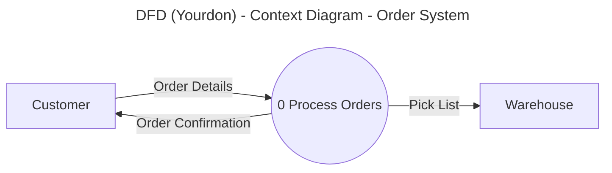

 
# Data Flow Diagram (Yourdon Notation)
 
## Workflow
 
1. **Find the task type.** The user wants one of these:
   - An explanation of the diagram.
   - A new diagram (as diagram code).
   - A document, guide, or procedure about the diagram.
   - A review of an existing diagram.
2. **Find the notation.** This skill uses Yourdon notation. If the user asks for Gane-Sarson notation, say that this skill does not cover it. Then ask if the user wants Yourdon notation.
3. **Get the inputs.** Use the **Inputs** list in this skill. If the user gave enough data, continue. If data is missing, state your assumptions in one line, or ask one question. Do not ask more than one.
4. **Write the output.** Follow the STE writing rules. Use the output format for the task type.
5. **Check the output.** Do the final check at the end of this file.
6. **Check the fit.** If another diagram fits the need better, say so in one sentence. Related diagrams: Activity Diagram (for control flow and decisions), Sequence Diagram (for message order).
## Output formats
 
**Explanation (chat).** Give the Purpose in one or two sentences. Then give the part that the user asked for (inputs, symbols, procedure, or rules). Do not copy the whole section if the user asked a narrow question.
 
**New diagram.** Give the diagram as code in a fenced block. Then add a short STE note: what the diagram shows and which rules you applied. Code format for this diagram: Mermaid `flowchart`. Use these shapes:
 
| Element | Mermaid shape |
|---|---|
| External entity | Rectangle: `ID[Name]` |
| Process | Circle: `ID((Number Name))` |
| Data store | Subroutine box: `ID[[Name]]` |
| Data flow | Labeled arrow: `A -->|Data Name| B` |
 
> **NOTE:** Mermaid has no open-ended rectangle (two parallel lines). Use the subroutine box for a data store. Add a NOTE that names the difference. PlantUML has the same limit.
 
Example (Context Diagram):
 

 
**Document or guide.** Write Markdown. Use the five-part structure: Purpose, Inputs, Symbols, Procedure, Rules. If the user wants a file, make a `.md` file (or the format that they name).
 
**Review.** List each problem with the rule that it breaks. Give the fix for each problem. Put the most serious problems first.
 
## STE writing rules
 
Apply these rules to all text that you write for this skill. They follow the main ideas of ASD-STE100. You cannot check against the official dictionary, so do not claim full compliance. If the user needs official compliance, tell them to use an STE checker.
 
**Sentences**
1. Write procedure sentences with 20 words or fewer. Write descriptive sentences with 25 words or fewer.
2. Give one instruction in each sentence.
3. Start each procedure step with a verb in the imperative (for example, "Draw the lifeline.").
4. Put a condition at the start of the sentence (for example, "If the object has no name, use `:Class`.").
5. Limit each paragraph to six sentences.
6. Use a vertical list for three or more items.
**Words**
7. Use one word for one meaning. Use the same word for the same thing in all places. Do not use synonyms to make the text "more interesting".
8. Use simple verbs: *use* (not *utilize*), *make sure* (not *ensure*), *start* (not *initiate*), *show* (not *illustrate*).
9. Do not use phrasal verbs or idioms (for example, "set up", "carry out", "rule of thumb"). Use a single verb: *install*, *do*, *guideline*.
10. Use the articles *a*, *an*, and *the*. Do not drop them.
11. Do not use contractions (write "do not", not "don't"). Do not use "e.g." or "i.e." Write "for example" and "that is".
12. Keep noun clusters to three words or fewer. Use *of* or *for* to break a long cluster.
13. Spell out an abbreviation the first time that you use it.
 
**Grammar**
14. Use the active voice. Do not use the passive voice, unless the actor is not known.
15. Use the simple present tense for facts and rules. Use the imperative for instructions. Use the simple future ("will") only for a result in a later step.
16. Do not use the *-ing* form as a verb. Use it only in a technical name (for example, "Timing Diagram").
17. Use *can* for ability. Use *must* for a rule that you cannot break. Use *should* only for a good practice.
 
**Safety and notes**
18. Put a WARNING before a step that can cause a serious error or an unsafe design. Put a CAUTION before a step that can cause a small error. Put a NOTE for extra information.
19. Write each WARNING, CAUTION, and NOTE as a short, direct statement.
 
## General rules for all diagrams
 
Apply these rules to each diagram that you make or review.
 
1. Decide the audience before you start. Make the diagram for that audience.
2. Show one level of detail in one diagram. Do not mix high-level and low-level items.
3. Give each element a short, clear name. Use the same name for the same item in all diagrams.
4. Use nouns for things. Use verbs for actions.
5. Use only standard symbols. If you use a non-standard symbol, add a legend.
6. Put a title on each diagram. Show the diagram type and the scope.
7. Do not cross lines if you can avoid it.
8. Limit each diagram to about 7 to 15 main elements. If the diagram has more, split it.
9. Make sure that each element has a reason to be there. Remove all other elements.
10. Ask a second person to review the diagram before release.
---
 
# Data Flow Diagram (DFD) Reference - Yourdon Notation
 
## Purpose
 
The Data Flow Diagram (DFD) shows how data enters a system, how processes change it, and where it is stored. It does not show control flow or time. Yourdon notation (also called Yourdon-DeMarco notation) uses circles for processes.
 
## Inputs
 
- A list of the external entities (sources and destinations of data).
- A list of the processes.
- A list of the data stores.
- A list of the data items that move between them.
- A data dictionary that defines each data flow and each data store (if the user has one).
## Symbols
 
| Symbol | Meaning |
|---|---|
| Rectangle | An external entity (also called a terminator) |
| Circle (bubble) | A process |
| Two parallel horizontal lines (open-ended rectangle) | A data store |
| Arrow with a label | A data flow |
 
> **NOTE:** Gane-Sarson notation uses a rounded rectangle for a process. Do not use it in Yourdon notation.
 
## Procedure
 
1. Draw the Context Diagram. Show the system as one circle. Show all external entities and all data flows.
2. Divide the system into 5 to 9 main processes. Draw them as Diagram 0.
3. Add the data stores that the processes use.
4. Draw the data flows. Label each flow with a noun that names the data.
5. Number each process with a whole number (for example, 1, 2, 3).
6. Divide a complex process into a child diagram. Number its processes with the parent number (for example, 2.1, 2.2). Do this only if necessary.
7. Check that the data flows at each child diagram match the parent process.
8. Define each data flow and each data store in the data dictionary.
9. Write a process specification for each process that you do not divide further (a primitive process).
## Rules
 
- Give each process at least one input flow and at least one output flow.
- Do not make a process that has only outputs (a miracle).
- Do not make a process that has only inputs (a black hole).
- Make sure that each output of a process can come from its inputs (no gray hole).
- Do not connect two external entities directly.
- Do not connect two data stores directly.
- Do not connect an external entity directly to a data store.
- Name a process with a verb and a noun (for example, `Validate Order`).
- Name a data flow with a noun (for example, `Order Details`).
- Name a data store with a plural noun (for example, `Orders`).
- Make sure that the child diagram has the same inputs and outputs as its parent process. This is "balancing".
- Show a data store on a child diagram only if the parent diagram does not show it. Show the store at the highest level where two or more processes use it.
> **CAUTION:** Do not show decisions or loops in a DFD. Use an Activity Diagram for that.
 
---
 
## Final check
 
Do this check before you give the output to the user.
 
1. Make sure that the diagram has a title and a diagram type.
2. Make sure that all symbols follow Yourdon notation, or that a legend explains them.
3. Make sure that names are clear and consistent.
4. Make sure that the diagram follows the Rules section of this skill.
5. Make sure that the level of detail is correct for the audience.
6. Make sure that the text follows the STE writing rules.
7. If you gave diagram code, make sure that the syntax is valid for the tool.