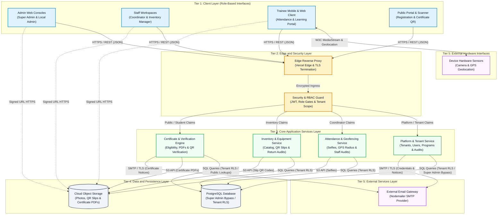
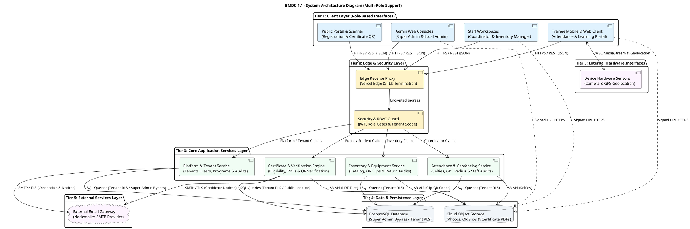

# BMDC 1.1 - Comprehensive System Architecture Diagram
## Multi-Tier System Architecture and Infrastructure Integration

**Version:** 1.0  
**Last Updated:** November 2026  
**System:** BMDC 1.1 - Trainee Management & Attendance Tracking Platform  
**Document Standard:** ASD-STE100 Principles (Simplified Technical English)

---

## 1. Purpose

This document provides the official system architecture diagram for the BMDC 1.1 platform. The diagram shows the main system parts and their communication paths.

The architecture includes:
- Role-based client interfaces for Super Admins, Local Admins, Staff Members, Trainees, and Public Visitors.
- Edge ingress, TLS termination, and Role-Based Access Control (RBAC) security gateways.
- Core backend application services partitioned by operational responsibility.
- Multi-tenant relational persistence with Row-Level Security (RLS) and cloud object storage.
- External hardware sensors and email communication services.

This document gives both Mermaid flowchart and PlantUML component code formats.

---

## 2. Inputs

The system architecture requires these elements:
- A list of client applications and input devices.
- An edge reverse proxy and authentication gateway.
- A list of core backend application services.
- The primary relational database and object storage buckets.
- External notification providers and hardware sensor interfaces.
- The communication protocol and payload format for each link.

---

## 3. Symbols

This document uses standard system architecture diagram symbols:

| Symbol | Shape | Meaning |
|---|---|---|
| Rectangle | `[Name]` | A client application, server process, or internal service |
| Cylinder | `[(Name)]` | A database, data table, or file storage system |
| Cloud shape | `[Name]` with cloud label | An external system, network, or provider |
| Solid arrow | `-->` | Direct request or synchronous communication flow |
| Dashed arrow | `-.->` | Direct media download via pre-signed uniform resource locator |
| Outer box | `subgraph` | A logical tier boundary or network isolation zone |

---

## 4. Procedure

Follow these procedure steps to construct and read the system architecture:

1. Identify the five architectural tiers of the system.
2. Place the client applications in the Client Layer at the top of the diagram.
3. Connect client devices to physical sensors through standard browser interfaces.
4. Route all incoming client traffic through the Edge and Security Layer.
5. Validate security tokens and resolve tenant context before routing to services.
6. Group business logic into four core services in the Application Layer.
7. Connect each core service to the shared PostgreSQL database.
8. Enforce tenant isolation at the database level with Row-Level Security policies.
9. Route binary media uploads and certificate documents to object storage.
10. Send outbound notification emails through the external mail gateway.
11. Label each link with its network protocol and data payload type.
12. Review the final diagram to make sure the element count stays between 7 and 15 items.

---

## 5. Rules

Apply these rules to the system architecture diagram:

1. Limit the diagram to 14 primary system nodes across five tiers.
2. Label every communication arrow with its protocol and data format.
3. Route all public and internal requests through the edge proxy before backend service access.
4. Separate client hardware interfaces from server-side external services.
5. Isolate tenant data within the database by using the tenant identifier and Row-Level Security policies.
6. Grant the Super Admin role platform-level database bypass for cross-tenant administration.
7. Store files, QR images, and document binaries in cloud object storage instead of database records.
8. Use Simple Mail Transfer Protocol over Transport Layer Security for all notification emails.
9. Use JavaScript Object Notation over Hypertext Transfer Protocol Secure for Application Programming Interface requests.

> **CAUTION:** Do not place server internet protocol addresses or private keys in the architecture diagram.

---

## 6. Comprehensive System Architecture Diagram

### Diagram Overview

The system architecture organizes components into five distinct tiers that serve all platform roles:
- **Tier 1 (Client Layer):** Dedicated web consoles for Super Admins and Local Admins, operational staff desks for Coordinators and Inventory Managers, trainee self-service clients, and public portals.
- **Tier 2 (Edge & Security Layer):** Vercel edge reverse proxy, transport layer security termination, and Role-Based Access Control security middleware.
- **Tier 3 (Application Core Services Layer):** Platform and tenant management, attendance and geofence evaluation, equipment inventory and slip generation, and certificate verification.
- **Tier 4 (Data & Persistence Layer):** Supabase PostgreSQL database with Row-Level Security and Super Admin bypass, and cloud object storage.
- **Tier 5 (External Services Layer):** Simple Mail Transfer Protocol email gateway and client hardware sensor interfaces.

---

### Mermaid Flowchart Code

---

### PlantUML Component Diagram Code

---

## 7. Role-Based Architectural Workflows

This section defines how each role interacts with the architectural tiers:

### 1. Super Admin (Platform Administration)
- **Client Interface (`CLI_ADMIN`):** Accesses `/admin/tenants`, `/admin/users`, `/admin/reports`, and `/admin/settings`.
- **Security & Authorization (`SEC_RBAC`):** Validated with platform-level authorization claims (`role: super_admin`).
- **Application Services (`SVC_ADMIN`):** Manages tenant lifecycle (create, edit, suspend), global system settings, theme presets, and system audit logs.
- **Persistence (`DB_PG`):** Bypasses Row-Level Security policies to execute cross-tenant queries and platform analytics.

### 2. Local Admin (Organization & LGU Management)
- **Client Interface (`CLI_ADMIN`):** Accesses `/registrations`, `/trainees`, `/programs`, `/staff`, and `/reports`.
- **Security & Authorization (`SEC_RBAC`):** Validated with tenant-level authorization claims and extracted tenant identifier (`tenant_id`).
- **Application Services (`SVC_ADMIN`):** Reviews pending trainee registrations, provisions staff accounts (Training Coordinators and Inventory Managers), creates training programs, and configures organization preferences.
- **Persistence (`DB_PG`):** Strictly restricted by PostgreSQL Row-Level Security policies to the local tenant boundary.

### 3. Staff Training Coordinator (Attendance & Academic Operations)
- **Client Interface (`CLI_STAFF`):** Accesses `/attendance`, `/attendance/audit`, `/programs`, `/sessions`, and `/certificates`.
- **Security & Authorization (`SEC_RBAC`):** Granted functional coordinator permissions (`attendance:audit`, `programs:manage`).
- **Application Services (`SVC_ATT` & `SVC_CERT`):** Sets daily session time windows, configures non-attendance dates, audits trainee selfie photographs and GPS records, flags attendance exceptions, and triggers batch certificate generation.
- **Persistence (`DB_PG` & `STO_OBJ`):** Queries attendance and enrollment tables scoped to tenant; accesses signed selfie URLs from object storage.

### 4. Staff Inventory Manager (Equipment & Material Management)
- **Client Interface (`CLI_STAFF`):** Accesses `/inventory`, `/lendings`, `/borrowing-slips`, and `/items`.
- **Security & Authorization (`SEC_RBAC`):** Granted inventory management permissions (`inventory:manage`, `lendings:manage`).
- **Application Services (`SVC_INV`):** Maintains item catalog, monitors stock levels, generates and prints item QR codes, processes equipment borrowing requests, issues official borrowing slips, and inspects returned items for damage.
- **Persistence (`DB_PG` & `STO_OBJ`):** Updates stock quantities, persists lending records, and stores rendered slip QR codes.

### 5. Trainee (Self-Service Learning Portal)
- **Client Interface (`CLI_TRAINEE`):** Mobile and desktop responsive interface for course enrollment, daily attendance marking, borrowing requests, and certificate downloads.
- **Hardware Integration (`EXT_SENS`):** Uses browser W3C MediaStream API for camera selfies and Geolocation API for GPS coordinates.
- **Persistence (`DB_PG` & `STO_OBJ`):** Reads enrolled program data and downloads signed certificate PDFs.

### 6. Public Visitor & Verifier (External Engagement)
- **Client Interface (`CLI_PUB`):** Public registration form and public certificate verification screen.
- **Application Services (`SVC_ADMIN` & `SVC_CERT`):** Submits new applicant registration data without authentication; validates certificate authenticity by querying certificate verification hashes.

---

## 8. Final Verification Checklist

Do this check before releasing the architecture document:

- [x] **Title and Type:** The document includes a title and names the System Architecture Diagram type.
- [x] **Element Limit:** The diagram contains 14 nodes across five tiers, within the target range of 7 to 15 elements.
- [x] **Multi-Role Coverage:** Dedicated interfaces and workflows for Super Admin, Local Admin, Staff Training Coordinator, Staff Inventory Manager, Trainee, and Public Verifier are explicitly documented.
- [x] **Standard Shapes:** Rectangles represent services and clients; cylinders represent databases and file stores; cloud shapes represent external systems.
- [x] **Tier Boundaries:** Subgraphs group elements into five logical tiers.
- [x] **Connection Labels:** Every connection line specifies the communication protocol and data format.
- [x] **Flow Directions:** Arrows show the direction of requests and data flow.
- [x] **ASD-STE100 Rules:** All sentences follow length limits, active voice, and simple technical words.
- [x] **Dual Code Formats:** Both Mermaid flowchart and PlantUML blocks are verified and syntactically valid.

