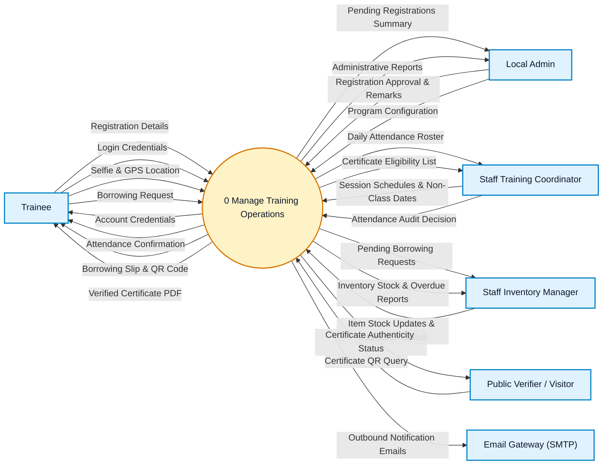

# BMDC 1.1 - Comprehensive Data Flow Diagram
## System Data Flow Specifications in Yourdon Notation

**Version:** 1.0  
**Last Updated:** November 2026  
**System:** BMDC 1.1 - Trainee Management & Attendance Tracking Platform  
**Document Standard:** ASD-STE100 Principles (Simplified Technical English)  
**Notation:** Yourdon-DeMarco Data Flow Notation

---

## 1. Purpose

This document provides the official Data Flow Diagram (DFD) for the BMDC 1.1 platform. The diagram shows how data enters the system, how processes change the data, and where the system stores the data.

This document does not show sequence, control logic, or decision loops. Those items belong in the Activity Diagram.

This document contains two hierarchy levels:
- **Context Diagram (Level 0):** High-level view of the system boundary and external entities.
- **Diagram 0 (Level 1):** Decomposition into six core processes and six persistent data stores.

Both Mermaid flowchart and PlantUML diagram code formats are provided.

---

## 2. Inputs

The Data Flow Diagram requires these elements:
- External entities (data sources and data destinations).
- Core system transformation processes.
- Persistent data stores.
- Named data items that travel along each flow.
- A data dictionary that defines each data flow and each data store.

---

## 3. Symbols

This document uses Yourdon notation symbols:

| Symbol | Shape | Meaning |
|---|---|---|
| Rectangle | `ID[Name]` | An external entity (data source or destination) |
| Circle (bubble) | `ID((Number Name))` | A process that transforms data |
| Parallel horizontal lines | `ID[[Name]]` | A persistent data store |
| Directed arrow | `-->|Data Name|` | A pipeline of moving data |

> **NOTE:** Mermaid and PlantUML do not draw open-ended parallel lines. This document uses the subroutine box `[[Name]]` for data stores in Mermaid.

---

## 4. Procedure

Follow these procedure steps to construct and read the Data Flow Diagram:

1. Identify all external entities that exchange data with the system.
2. Draw the Context Diagram with the entire system as Process 0.
3. Connect all external entities to Process 0 with labeled data flows.
4. Decompose the system into six core processes for Diagram 0.
5. Number each process with a whole number from 1 to 6.
6. Name each process with an active verb and a specific noun.
7. Identify the six shared data stores and name them with plural nouns.
8. Connect entities to processes that receive their data.
9. Connect processes to data stores that persist or supply their records.
10. Connect processes to entities that receive their output data.
11. Label every data flow with a noun that describes the data.
12. Make sure that no external entity connects directly to another external entity.
13. Make sure that no external entity connects directly to a data store.
14. Make sure that no data store connects directly to another data store.
15. Check that every process has at least one input flow and at least one output flow.

---

## 5. Rules

Apply these Yourdon notation rules to the Data Flow Diagram:

1. Give each process at least one incoming data flow and at least one outgoing data flow.
2. Do not create a process that has only outgoing data flows (miracle).
3. Do not create a process that has only incoming data flows (black hole).
4. Make sure that all output data from a process can come from its inputs (no gray hole).
5. Do not connect two external entities directly.
6. Do not connect two data stores directly.
7. Do not connect an external entity directly to a data store without an intermediate process.
8. Name every process with a verb and a noun (for example, `Register Trainee`).
9. Name every data flow with a descriptive noun (for example, `Registration Application`).
10. Name every data store with a plural noun (for example, `Attendance Records`).
11. Do not place decision diamonds, branching gates, or loops in this diagram.
12. Balance all external flows between the Context Diagram and Diagram 0.

---

## 6. Context Diagram (Level 0)

### Overview

The Context Diagram defines the system boundary. It represents the entire BMDC 1.1 platform as a single central process `((0 Manage Training Operations))`. Six external entities interact with the system.

### Mermaid Code (Context Diagram)

---

### PlantUML Code (Context Diagram)

```plantuml
@startuml
skinparam Shadowing false
skinparam defaultFontName Arial
skinparam roundCorner 8

title BMDC 1.1 - Data Flow Context Diagram (Level 0)

[Trainee] as ENT_TRAINEE #E0F2FE
[Local Admin] as ENT_ADMIN #E0F2FE
[Staff Training Coordinator] as ENT_COORD #E0F2FE
[Staff Inventory Manager] as ENT_INV #E0F2FE
[Public Verifier / Visitor] as ENT_PUBLIC #E0F2FE
[Email Gateway (SMTP)] as ENT_MAIL #E0F2FE

(0 Manage Training Operations) as SYS_MAIN #FEF3C7

' Trainee Flows
ENT_TRAINEE --> SYS_MAIN : Registration Details
ENT_TRAINEE --> SYS_MAIN : Login Credentials
ENT_TRAINEE --> SYS_MAIN : Selfie & GPS Location
ENT_TRAINEE --> SYS_MAIN : Borrowing Request
SYS_MAIN --> ENT_TRAINEE : Account Credentials
SYS_MAIN --> ENT_TRAINEE : Attendance Confirmation
SYS_MAIN --> ENT_TRAINEE : Borrowing Slip & QR Code
SYS_MAIN --> ENT_TRAINEE : Verified Certificate PDF

' Local Admin Flows
ENT_ADMIN --> SYS_MAIN : Registration Approval & Remarks
ENT_ADMIN --> SYS_MAIN : Program Configuration
SYS_MAIN --> ENT_ADMIN : Pending Registrations Summary
SYS_MAIN --> ENT_ADMIN : Administrative Reports

' Staff Coordinator Flows
ENT_COORD --> SYS_MAIN : Session Schedules & Non-Class Dates
ENT_COORD --> SYS_MAIN : Attendance Audit Decision
SYS_MAIN --> ENT_COORD : Daily Attendance Roster
SYS_MAIN --> ENT_COORD : Certificate Eligibility List

' Staff Inventory Manager Flows
ENT_INV --> SYS_MAIN : Item Stock Updates & Inspection Status
SYS_MAIN --> ENT_INV : Pending Borrowing Requests
SYS_MAIN --> ENT_INV : Inventory Stock & Overdue Reports

' Public Verifier Flows
ENT_PUBLIC --> SYS_MAIN : Certificate QR Query
SYS_MAIN --> ENT_PUBLIC : Certificate Authenticity Status

' Mail Gateway Flows
SYS_MAIN --> ENT_MAIL : Outbound Notification Emails

@enduml
```

---

## 7. Diagram 0: Level 1 Comprehensive Data Flow Diagram

### Overview

Diagram 0 decomposes Process 0 into six discrete functional processes, six persistent data stores, and six external entities. All data flows balance with the Level 0 Context Diagram.

The six processes are:
1. `1 Register User & Trainee`
2. `2 Authenticate & Authorize User`
3. `3 Manage Programs & Enrollments`
4. `4 Track Attendance & Geofencing`
5. `5 Manage Equipment & Borrowing Slips`
6. `6 Issue & Verify Certificates`

The six data stores are:
- `D1 Trainees & Users`
- `D2 Programs & Enrollments`
- `D3 Attendance Records`
- `D4 Equipment & Borrowing Slips`
- `D5 Certificates`
- `D6 Activity Logs`

---

### Mermaid Code (Diagram 0)

```mermaid
flowchart TD
    %% =========================================================================
    %% BMDC 1.1 - DIAGRAM 0 (LEVEL 1 COMPREHENSIVE DFD - YOURDON NOTATION)
    %% =========================================================================

    %% External Entities
    subgraph External_Entities ["External Entities (Terminators)"]
        ENT_TRAINEE["Trainee"]
        ENT_ADMIN["Local Admin"]
        ENT_COORD["Staff Training Coordinator"]
        ENT_INV["Staff Inventory Manager"]
        ENT_PUBLIC["Public Verifier / Visitor"]
        ENT_MAIL["Email Gateway (SMTP)"]
    end

    %% Data Stores
    subgraph Data_Stores ["Data Stores (Supabase PostgreSQL / Storage)"]
        DS_USERS[["D1 Trainees & Users"]]
        DS_PROGS[["D2 Programs & Enrollments"]]
        DS_ATT[["D3 Attendance Records"]]
        DS_EQUIP[["D4 Equipment & Borrowing Slips"]]
        DS_CERTS[["D5 Certificates"]]
        DS_LOGS[["D6 Activity Logs"]]
    end

    %% Processes
    P1((1 Register User & Trainee))
    P2((2 Authenticate & Authorize User))
    P3((3 Manage Programs & Enrollments))
    P4((4 Track Attendance & Geofencing))
    P5((5 Manage Equipment & Borrowing Slips))
    P6((6 Issue & Verify Certificates))

    %% --- Process 1: Register User & Trainee ---
    ENT_TRAINEE -->|Registration Application| P1
    ENT_ADMIN -->|Approval Decision & Remarks| P1
    P1 -->|Pending Applicant Summary| ENT_ADMIN
    P1 -->|Registration Acknowledgment| ENT_TRAINEE
    P1 -->|Login Credentials Notification| ENT_MAIL
    P1 -->|New User & Trainee Records| DS_USERS
    DS_USERS -->|Existing Candidate Profile| P1
    P1 -->|Registration Audit Event| DS_LOGS

    %% --- Process 2: Authenticate & Authorize User ---
    ENT_TRAINEE -->|Login Credentials| P2
    ENT_ADMIN -->|Login Credentials| P2
    ENT_COORD -->|Login Credentials| P2
    ENT_INV -->|Login Credentials| P2
    DS_USERS -->|Stored Credentials & Roles| P2
    P2 -->|JWT Session & Roles| ENT_TRAINEE
    P2 -->|JWT Session & Roles| ENT_ADMIN
    P2 -->|JWT Session & Roles| ENT_COORD
    P2 -->|JWT Session & Roles| ENT_INV
    P2 -->|Authentication Audit Event| DS_LOGS

    %% --- Process 3: Manage Programs & Enrollments ---
    ENT_ADMIN -->|Program Configuration Details| P3
    ENT_COORD -->|Session Schedules & Non-Class Dates| P3
    DS_USERS -->|Approved Trainee Record| P3
    P3 -->|Program & Enrollment Records| DS_PROGS
    DS_PROGS -->|Active Program Schedule| P3
    P3 -->|Course Roster Details| ENT_COORD
    P3 -->|Program Assignment Summary| ENT_ADMIN
    P3 -->|Enrolled Program Details| ENT_TRAINEE

    %% --- Process 4: Track Attendance & Geofencing ---
    ENT_TRAINEE -->|Selfie Photo & GPS Coordinates| P4
    ENT_COORD -->|Attendance Audit Decision| P4
    DS_PROGS -->|Geofence Center & Time Windows| P4
    DS_USERS -->|Enrolled Trainee Identity| P4
    P4 -->|Validated Attendance Record| DS_ATT
    DS_ATT -->|Attendance History & Percentage| P4
    P4 -->|Daily Attendance Status| ENT_TRAINEE
    P4 -->|Attendance Exception Summary| ENT_COORD
    P4 -->|Attendance Audit Log| DS_LOGS

    %% --- Process 5: Manage Equipment & Borrowing Slips ---
    ENT_TRAINEE -->|Equipment Borrowing Request| P5
    ENT_INV -->|Item Stock Updates & Return Audit| P5
    DS_USERS -->|Borrower Verification Data| P5
    DS_EQUIP -->|Available Stock & Slip Status| P5
    P5 -->|Updated Item Stock & Slip Data| DS_EQUIP
    P5 -->|Generated Borrowing Slip & QR Code| ENT_TRAINEE
    P5 -->|Lending Handover Slip| ENT_INV
    P5 -->|Inventory Movement Log| DS_LOGS

    %% --- Process 6: Issue & Verify Certificates ---
    ENT_COORD -->|Certification Generation Request| P6
    ENT_PUBLIC -->|Certificate QR Query| P6
    DS_PROGS -->|Program Completion Criteria| P6
    DS_ATT -->|Total Attendance Percentage| P6
    DS_USERS -->|Candidate Identity Details| P6
    P6 -->|Generated Certificate Record & QR| DS_CERTS
    DS_CERTS -->|Certificate Registry Record| P6
    P6 -->|Verified Certificate PDF| ENT_TRAINEE
    P6 -->|Authenticity Status Report| ENT_PUBLIC
    P6 -->|Certificate Issuance Notification| ENT_MAIL
    P6 -->|Certificate Audit Event| DS_LOGS

    %% Node Styling
    classDef entityStyle fill:#e0f2fe,stroke:#0284c7,stroke-width:2px,color:#0f172a;
    classDef processStyle fill:#fef3c7,stroke:#d97706,stroke-width:2px,color:#0f172a;
    classDef storeStyle fill:#f1f5f9,stroke:#475569,stroke-width:2px,color:#0f172a;

    class ENT_TRAINEE,ENT_ADMIN,ENT_COORD,ENT_INV,ENT_PUBLIC,ENT_MAIL entityStyle;
    class P1,P2,P3,P4,P5,P6 processStyle;
    class DS_USERS,DS_PROGS,DS_ATT,DS_EQUIP,DS_CERTS,DS_LOGS storeStyle;
```

---

### PlantUML Code (Diagram 0)

```plantuml
@startuml
skinparam Shadowing false
skinparam defaultFontName Arial
skinparam roundCorner 8

title BMDC 1.1 - Diagram 0: Level 1 Comprehensive Data Flow Diagram

package "External Entities" {
    [Trainee] as ENT_TRAINEE #E0F2FE
    [Local Admin] as ENT_ADMIN #E0F2FE
    [Staff Training Coordinator] as ENT_COORD #E0F2FE
    [Staff Inventory Manager] as ENT_INV #E0F2FE
    [Public Verifier / Visitor] as ENT_PUBLIC #E0F2FE
    [Email Gateway (SMTP)] as ENT_MAIL #E0F2FE
}

package "Data Stores" {
    database "D1 Trainees & Users" as DS_USERS #F1F5F9
    database "D2 Programs & Enrollments" as DS_PROGS #F1F5F9
    database "D3 Attendance Records" as DS_ATT #F1F5F9
    database "D4 Equipment & Borrowing Slips" as DS_EQUIP #F1F5F9
    database "D5 Certificates" as DS_CERTS #F1F5F9
    database "D6 Activity Logs" as DS_LOGS #F1F5F9
}

(1 Register User & Trainee) as P1 #FEF3C7
(2 Authenticate & Authorize User) as P2 #FEF3C7
(3 Manage Programs & Enrollments) as P3 #FEF3C7
(4 Track Attendance & Geofencing) as P4 #FEF3C7
(5 Manage Equipment & Borrowing Slips) as P5 #FEF3C7
(6 Issue & Verify Certificates) as P6 #FEF3C7

' Process 1 Flows
ENT_TRAINEE --> P1 : Registration Application
ENT_ADMIN --> P1 : Approval Decision & Remarks
P1 --> ENT_ADMIN : Pending Applicant Summary
P1 --> ENT_TRAINEE : Registration Acknowledgment
P1 --> ENT_MAIL : Login Credentials Notification
P1 --> DS_USERS : New User & Trainee Records
DS_USERS --> P1 : Existing Candidate Profile
P1 --> DS_LOGS : Registration Audit Event

' Process 2 Flows
ENT_TRAINEE --> P2 : Login Credentials
ENT_ADMIN --> P2 : Login Credentials
ENT_COORD --> P2 : Login Credentials
ENT_INV --> P2 : Login Credentials
DS_USERS --> P2 : Stored Credentials & Roles
P2 --> ENT_TRAINEE : JWT Session & Roles
P2 --> ENT_ADMIN : JWT Session & Roles
P2 --> ENT_COORD : JWT Session & Roles
P2 --> ENT_INV : JWT Session & Roles
P2 --> DS_LOGS : Authentication Audit Event

' Process 3 Flows
ENT_ADMIN --> P3 : Program Configuration Details
ENT_COORD --> P3 : Session Schedules & Non-Class Dates
DS_USERS --> P3 : Approved Trainee Record
P3 --> DS_PROGS : Program & Enrollment Records
DS_PROGS --> P3 : Active Program Schedule
P3 --> ENT_COORD : Course Roster Details
P3 --> ENT_ADMIN : Program Assignment Summary
P3 --> ENT_TRAINEE : Enrolled Program Details

' Process 4 Flows
ENT_TRAINEE --> P4 : Selfie Photo & GPS Coordinates
ENT_COORD --> P4 : Attendance Audit Decision
DS_PROGS --> P4 : Geofence Center & Time Windows
DS_USERS --> P4 : Enrolled Trainee Identity
P4 --> DS_ATT : Validated Attendance Record
DS_ATT --> P4 : Attendance History & Percentage
P4 --> ENT_TRAINEE : Daily Attendance Status
P4 --> ENT_COORD : Attendance Exception Summary
P4 --> DS_LOGS : Attendance Audit Log

' Process 5 Flows
ENT_TRAINEE --> P5 : Equipment Borrowing Request
ENT_INV --> P5 : Item Stock Updates & Return Audit
DS_USERS --> P5 : Borrower Verification Data
DS_EQUIP --> P5 : Available Stock & Slip Status
P5 --> DS_EQUIP : Updated Item Stock & Slip Data
P5 --> ENT_TRAINEE : Generated Borrowing Slip & QR Code
P5 --> ENT_INV : Lending Handover Slip
P5 --> DS_LOGS : Inventory Movement Log

' Process 6 Flows
ENT_COORD --> P6 : Certification Generation Request
ENT_PUBLIC --> P6 : Certificate QR Query
DS_PROGS --> P6 : Program Completion Criteria
DS_ATT --> P6 : Total Attendance Percentage
DS_USERS --> P6 : Candidate Identity Details
P6 --> DS_CERTS : Generated Certificate Record & QR
DS_CERTS --> P6 : Certificate Registry Record
P6 --> ENT_TRAINEE : Verified Certificate PDF
P6 --> ENT_PUBLIC : Authenticity Status Report
P6 --> ENT_MAIL : Certificate Issuance Notification
P6 --> DS_LOGS : Certificate Audit Event

@enduml
```

---

## 8. Data Dictionary

This data dictionary defines the primary data flows and data stores:

### Data Stores

| Data Store | Storage Mechanism | Description |
|---|---|---|
| `D1 Trainees & Users` | PostgreSQL `users`, `trainees`, `users_tenants` | Stores user credentials, hashed passwords, personal profiles, and tenant associations. |
| `D2 Programs & Enrollments` | PostgreSQL `programs`, `enrollments`, `sessions` | Stores course specifications, session schedules, geofence coordinates, and trainee enrollment statuses. |
| `D3 Attendance Records` | PostgreSQL `attendance`, `attendance_exceptions` | Stores daily morning and afternoon timestamps, selfie photo paths, device metadata, and audit remarks. |
| `D4 Equipment & Borrowing Slips` | PostgreSQL `items`, `lendings`, `borrowing_slips` | Stores inventory stock numbers, item categories, unique slip numbers, QR strings, and return inspection reports. |
| `D5 Certificates` | PostgreSQL `certificates` & Cloud Storage | Stores unique certificate numbers, issue dates, verification Uniform Resource Locators, and signed Portable Document Format files. |
| `D6 Activity Logs` | PostgreSQL `activity_logs` | Stores chronological audit logs of all user actions, logins, status changes, and administrative decisions. |

### Core Data Flows

| Data Flow Name | Direction | Description |
|---|---|---|
| `Registration Application` | Trainee → Process 1 | Personal details, contact information, educational background, and preferred training program. |
| `Approval Decision & Remarks` | Local Admin → Process 1 | Approval or rejection status with mandatory remarks for rejected applications. |
| `Login Credentials` | User → Process 2 | Username or email address and bcrypt-hashed password. |
| `JWT Session & Roles` | Process 2 → User | Signed JSON Web Token containing user identifier, tenant identifier, and authorized role. |
| `Selfie Photo & GPS Coordinates` | Trainee → Process 4 | Device camera image payload, latitude, longitude, and accuracy radius. |
| `Geofence Center & Time Windows` | Store D2 → Process 4 | Authorized program GPS center coordinates, 500-meter threshold, and scheduled morning/afternoon time boundaries. |
| `Generated Borrowing Slip & QR Code` | Process 5 → Trainee | Official digital receipt with unique slip identifier and machine-readable Quick Response code. |
| `Certificate QR Query` | Public Verifier → Process 6 | Public certificate identifier scanned from digital or printed certificate QR code. |
| `Authenticity Status Report` | Process 6 → Public Verifier | Validation response showing trainee full name, completed program, issuance date, and active authenticity status. |

---

## 9. Final Verification Checklist

Do this check before releasing the Data Flow Diagram document:

- [x] **Title and Type:** The document includes a title and names the Data Flow Diagram type in Yourdon notation.
- [x] **Yourdon Notation Compliance:** Processes are circles (`(( ))`), external entities are rectangles (`[ ]`), data stores are subroutine boxes (`[[ ]]`), and data flows are labeled arrows (`-->|Data|`).
- [x] **Process Integrity:** Every process has at least one input flow and at least one output flow.
- [x] **No Illegal Flows:** No external entity connects directly to another external entity, no external entity connects directly to a data store, and no data store connects directly to another data store.
- [x] **No Control Logic:** The diagram contains no decision diamonds, branching gates, or loops.
- [x] **Level Balancing:** All external flows between entities and Process 0 in the Context Diagram balance with the flows in Diagram 0.
- [x] **Naming Rules:** Process names use active verbs and nouns. Data flows use nouns. Data stores use plural nouns.
- [x] **ASD-STE100 Rules:** All sentences follow length limits, active voice, and simple technical words.
- [x] **Dual Code Formats:** Both Mermaid flowchart and PlantUML blocks are verified and syntactically valid.

