# BMDC 1.1 - Comprehensive System Activity Diagram
## Binary-Decision Whole-System Operational Lifecycle with Full Route Coverage

**Version:** 4.0  
**Last Updated:** November 2026  
**System:** BMDC 1.1 - Trainee Management & Attendance Tracking Platform  
**Document Standard:** ASD-STE100 Principles (Simplified Technical English)  
**Diagram Standard:** Unified Modeling Language (UML) 2.5 Activity Diagram Specification  
**Decision Gate Rule:** Strict Binary Branching (`[Yes]` and `[No]` exclusively)

---

## 1. Purpose

This document provides the official comprehensive activity diagram for the BMDC 1.1 platform. The workflow initiates at ingress and user login, validates credentials, evaluates the assigned user role through a binary decision cascade, and expands into dedicated operational workflows for:

- **Super Admin:** Platform-wide tenant onboarding, local admin account provisioning, and global telemetry audit.
- **Local Admin:** Organization setup, training program creation, staff provisioning, and registration approval.
- **Staff Training Coordinator:** Class schedule configuration, attendance photo auditing, and certificate evaluation.
- **Staff Inventory Manager:** Equipment catalog tracking, QR borrowing slip generation, and returned hardware condition inspection.
- **Trainee:** Dual parallel execution of geofenced selfie attendance and equipment borrowing, concluding with verified certificate downloads.
- **Public Visitor:** Candidate self-registration form submission and certificate QR authenticity verification.

Every decision gate in this document strictly uses binary `[Yes]` and `[No]` branch conditions.

---

## 2. Inputs

The workflow requires these parameters and data items:
- User login credentials (email or username, and password).
- System security tokens (JSON Web Token session with role claims and tenant identifier).
- Tenant organization data (name, contact, subscription status, and Local Admin assignment).
- Training program definitions (curriculum dates, capacity limits, and facility GPS center coordinates).
- Staff user accounts (Training Coordinator and Inventory Manager assignments).
- Candidate registration applications (personal data, contact details, and selected program).
- Program session schedules (morning 08:00–12:00 and afternoon 13:00–17:00).
- Trainee mobile camera photographs (selfies) and GPS location coordinates.
- Facility 500-meter geofence radius coordinates.
- Inventory item records, available stock counts, and borrowing requests.
- Physical equipment condition inspection reports and damage assessments.
- Program completion threshold of 80 percent cumulative verified attendance.
- Certificate QR code verification tokens.

---

## 3. Symbols

This document uses standard UML activity diagram symbols:

| Symbol | Name | Meaning | Mermaid Syntax |
|---|---|---|---|
| Filled black circle | Initial state | Start of the whole system workflow | `S((" ")):::dot` |
| Rounded rectangle | Action node | A discrete operation or task in the workflow | `A(Verb Noun)` |
| Directed arrow | Control flow | Direction and sequence of workflow transition | `-->` |
| Diamond with question text | Decision node | Binary point where control branches exclusively by Yes or No | `D{Question?}` |
| Solid thin bar (split) | Fork | Point where one flow splits into parallel concurrent actions | `F[" "]:::bar` |
| Solid thin bar (join) | Join | Point where parallel concurrent actions synchronize and finish together | `J[" "]:::bar` |
| Hexagon | Time event | Scheduled operational window or required time period | `T{{"Time Event: Window"}}` |
| Text in brackets | Guard condition | Strict binary condition (`[Yes]` or `[No]`) on outgoing flow | `-->\|"[Yes]"\|` / `-->\|"[No]"\|` |
| Boundary box | Swimlane | Boundary assigning actions to a specific actor or role | `subgraph Actor` |
| Double circle with dot | Final state | Successful completion or terminal end of a workflow route | `E(((" "))):::dot` |

> **NOTE:** Flow paths merge directly into target action nodes. No blank or empty diamonds are used in this diagram.

---

## 4. Route Coverage

The diagram models every route from the initial state to a terminal final state. Every decision uses binary `[Yes]` or `[No]` guards. The workflow contains 17 distinct routes covering ingress, authentication, role dispatching, operational branches, and error exits.

### Route Coverage Matrix

| Route ID | Route Type | Primary Actor | Description and Path Summary | Guard Conditions |
|---|---|---|---|---|
| **R1** | Main | Super Admin | Entry &rarr; Is Registered [Yes] &rarr; Credentials Valid [Yes] &rarr; Is Super Admin [Yes] &rarr; Onboard tenant &rarr; Provision Admin &rarr; Review telemetry &rarr; Terminal success. | `[Yes]`, `[Yes]`, `[Yes]` |
| **R2** | Main | Local Admin | Role: Is Super Admin [No] &rarr; Is Local Admin [Yes] &rarr; Configure org &rarr; Create program & geofence &rarr; Provision staff &rarr; Approve Applicant [Yes] &rarr; Terminal success. | `[No]`, `[Yes]`, `[Yes]` |
| **R3** | Alternative | Local Admin | Local Admin reviews registration &rarr; Approve Applicant [No] &rarr; Data Incomplete [No] &rarr; Record rejection reason &rarr; Dispatch notice &rarr; Abort. | `[No]`, `[No]` |
| **R4** | Retry Loop | Local Admin / Trainee | Local Admin reviews registration &rarr; Approve Applicant [No] &rarr; Data Incomplete [Yes] &rarr; Request applicant corrections &rarr; Update form &rarr; Re-review. | `[No]`, `[Yes]` |
| **R5** | Main | Training Coordinator | Role: Is Local Admin [No] &rarr; Is Coordinator [Yes] &rarr; Session schedules &rarr; Photo Valid [Yes] &rarr; Attendance &ge; 80% [Yes] &rarr; Trigger certificate generation &rarr; Terminal success. | `[No]`, `[Yes]`, `[Yes]`, `[Yes]` |
| **R6** | Alternative | Training Coordinator | Coordinator audits attendance &rarr; Photo Valid [No] &rarr; Record attendance exception &rarr; Join coordinator flow. | `[No]` |
| **R7** | Alternative | Training Coordinator | Coordinator evaluates completion &rarr; Attendance &ge; 80% [No] &rarr; Issue completion letter without certificate &rarr; Terminal ineligible. | `[No]` |
| **R8** | Main | Inventory Manager | Role: Is Coordinator [No] &rarr; Is Inventory Manager [Yes] &rarr; Item in Stock [Yes] &rarr; Handover &rarr; Undamaged [Yes] &rarr; Restock &rarr; Close slip &rarr; Terminal success. | `[No]`, `[Yes]`, `[Yes]`, `[Yes]` |
| **R9** | Alternative | Inventory Manager | Trainee requests item &rarr; Item in Stock [No] &rarr; Notify trainee out of stock &rarr; Abort borrowing path. | `[No]` |
| **R10** | Alternative | Inventory Manager | Trainee returns item &rarr; Undamaged [No] &rarr; Log damage report & assess liability &rarr; Close slip with damage flag &rarr; Terminal success. | `[No]` |
| **R11** | Main | Trainee | Role: Is Inventory Manager [No] (Default: Trainee) &rarr; Fork parallel operations &rarr; Window Open [Yes] &rarr; Inside Geofence [Yes] &rarr; Borrow & Return &rarr; Join &rarr; Download certificate &rarr; Terminal success. | `[No]`, `[Yes]`, `[Yes]` |
| **R12** | Error Exit | Trainee / System | Trainee requests attendance &rarr; Window Open [No] &rarr; Flag schedule closed error &rarr; Abort attendance flow. | `[No]` |
| **R13** | Retry Loop | Trainee / System | Trainee captures selfie & GPS &rarr; Inside Geofence [No] &rarr; Flag out-of-bounds error &rarr; Reposition device & retry. | `[No]` |
| **R14** | Retry Loop | User (All Roles) | Submit credentials &rarr; Credentials Valid [No] &rarr; Display authentication error &rarr; Prompt credential retry. | `[No]` |
| **R15** | Main (Public) | Candidate | Entry &rarr; Is Registered [No] &rarr; Is Scanning QR [No] &rarr; Complete registration form &rarr; Save pending record & dispatch acknowledgment &rarr; Terminal pending state. | `[No]`, `[No]` |
| **R16** | Main (Public) | Public Verifier | Entry &rarr; Is Registered [No] &rarr; Is Scanning QR [Yes] &rarr; Scan certificate QR code &rarr; Display authenticity status &rarr; Terminal verified state. | `[No]`, `[Yes]` |

---

## 5. Procedure

Follow these procedure steps to execute the binary-decision activity workflow:

### Phase 1: Ingress & Authentication Gateway
1. Start at the initial state (`START`).
2. If the user is registered, select `[Yes]` on `Is User Registered?` and proceed to login.
3. If the user is not registered, select `[No]` on `Is User Registered?` and evaluate `Is Scanning QR Code?`.
4. If scanning a certificate QR code, select `[Yes]`, scan the QR code, and view the authenticity status page.
5. If not scanning a QR code, select `[No]`, complete the candidate registration form, and await administrator review.
6. On the login screen, enter username or email and password.
7. Evaluate `Are Credentials Valid?`.
8. If credentials are invalid, select `[No]`, display an authentication error, and loop back to the login input.
9. If credentials are valid, select `[Yes]`, extract tenant context, and issue the JSON Web Token session.

### Phase 2: Binary Role Dispatching Cascade
10. Evaluate `Is User a Super Admin?`.
11. If the user is a Super Admin, select `[Yes]` and enter the Super Admin workflow.
12. If the user is not a Super Admin, select `[No]` and evaluate `Is User a Local Admin?`.
13. If the user is a Local Admin, select `[Yes]` and enter the Local Admin workflow.
14. If the user is not a Local Admin, select `[No]` and evaluate `Is User a Training Coordinator?`.
15. If the user is a Training Coordinator, select `[Yes]` and enter the Coordinator workflow.
16. If the user is not a Training Coordinator, select `[No]` and evaluate `Is User an Inventory Manager?`.
17. If the user is an Inventory Manager, select `[Yes]` and enter the Inventory Manager workflow.
18. If the user is not an Inventory Manager, select `[No]` and enter the Trainee workflow.

### Phase 3: Super Admin Operational Branch
19. Open the Super Admin Platform Console.
20. Onboard new tenant organizations.
21. Provision the primary Local Admin user account for each tenant.
22. Review platform-wide analytics and system audit logs.
23. Conclude at the Super Admin final state (`END_SUPER_ADMIN`).

### Phase 4: Local Admin Operational Branch
24. Open the Organization Admin Portal.
25. Configure organization preferences, center address, and branding.
26. Create training programs, define curriculum dates, and set the facility GPS center coordinates.
27. Provision user accounts for the Staff Training Coordinator and Staff Inventory Manager.
28. Review pending trainee registration applications.
29. Evaluate `Approve Registration Application?`.
30. If approved, select `[Yes]`, provision the trainee profile, create credentials, and assign enrollment.
31. If not approved, select `[No]` and evaluate `Is Application Data Incomplete?`.
32. If data is incomplete, select `[Yes]`, request applicant corrections, and loop back to applicant update.
33. If data is not incomplete (rejected), select `[No]`, record the rejection reason, send notice, and terminate.
34. Conclude at the Local Admin final state (`END_LOCAL_ADMIN`).

### Phase 5: Staff Training Coordinator Operational Branch
35. Open the Coordinator Workspace.
36. Configure session time windows and non-attendance dates.
37. Audit daily attendance submissions by inspecting selfie photographs and GPS coordinates.
38. Evaluate `Is Photo and Location Valid?`.
39. If valid, select `[Yes]` and confirm the attendance entry.
40. If invalid, select `[No]` and record an attendance exception record.
41. Evaluate `Attendance >= 80%?` when class sessions conclude.
42. If attendance is below 80 percent, select `[No]`, issue an official completion letter, and terminate.
43. If attendance is 80 percent or greater, select `[Yes]` and trigger batch certificate generation.
44. Conclude at the Coordinator final state (`END_COORDINATOR`).

### Phase 6: Staff Inventory Manager Operational Branch
45. Open the Inventory Desk.
46. Maintain the equipment catalog, track stock counts, and print item QR codes.
47. Receive trainee equipment borrowing requests.
48. Evaluate `Is Item Available in Stock?`.
49. If item is out of stock, select `[No]`, notify the trainee, and abort the borrowing path.
50. If item is in stock, select `[Yes]`, approve the request, deduct stock, and generate a QR borrowing slip.
51. Hand over the physical equipment to the trainee for classroom training.
52. Inspect the physical condition of returned equipment at session conclusion.
53. Evaluate `Is Equipment Undamaged?`.
54. If equipment is damaged, select `[No]`, record a damage report, and assess repair liability.
55. If equipment is undamaged, select `[Yes]`, confirm the return, and restore available stock.
56. Mark the borrowing slip returned and conclude at the Inventory final state (`END_INVENTORY`).

### Phase 7: Trainee Operational Branch
57. Open the Trainee Learning Dashboard.
58. Enter concurrent training operations via the parallel fork bar (`FORK_TRAINEE`).
59. If marking daily attendance (Branch A), evaluate `Is Session Window Open?`.
60. If the session window is closed, select `[No]`, flag a schedule closed error, and terminate.
61. If the session window is open, select `[Yes]`, capture a selfie photograph, and get device GPS coordinates.
62. Evaluate `Inside 500m Geofence Radius?`.
63. If outside the geofence radius, select `[No]`, prompt device repositioning, and retry capture.
64. If inside the geofence radius, select `[Yes]`, encrypt the photograph, and submit attendance.
65. If borrowing equipment (Branch B), submit an equipment borrowing request.
66. Receive the digital borrowing slip and QR code, use equipment in class, and return it to the manager.
67. Synchronize the parallel training branches at the join bar (`JOIN_TRAINEE`).
68. Download the verified certificate PDF file upon successful program completion.
69. Conclude at the Trainee final state (`END_TRAINEE`).

---

## 6. Rules

Apply these UML 2.5 rules to the binary-decision activity diagram:

1. Use only one initial state (`START`) for the entire system lifecycle.
2. End every execution branch at an explicit terminal final state.
3. Every decision node must have exactly two outgoing flows, labeled exclusively `[Yes]` and `[No]`.
4. Make all binary decision questions grammatically polar (answerable strictly by Yes or No).
5. Chain complex conditions as sequential binary decision gates instead of multi-way forks.
6. Merge alternative paths directly into destination action nodes without using blank or empty diamond shapes.
7. Match every parallel fork bar with a corresponding join bar that synchronizes all concurrent paths.
8. Do not leave any action node without an outgoing control flow.
9. Enforce the 500-meter radius limit for geofence validation.
10. Enforce the 80 percent attendance requirement for certificate generation.
11. Isolate all transactions by tenant identifier through Row-Level Security policies.
12. Format every generated certificate number as `CERT-YYYY-NNNNNN`.
13. Assign every action node to exactly one actor swimlane.

---

## 7. Comprehensive System Activity Diagram

### Mermaid Flowchart Code

```mermaid
flowchart TD
    %% =========================================================================
    %% BMDC 1.1 - BINARY-DECISION COMPREHENSIVE ACTIVITY DIAGRAM
    %% Strict Binary Decisions: Every decision diamond has only [Yes] and [No]
    %% Full Route Coverage Specification (R1 - R16) - UML 2.5 Standards
    %% =========================================================================

    classDef dot fill:#000,stroke:#000
    classDef bar fill:#000,stroke:#000,color:#000

    %% Initial Entry Point
    START((" ")):::dot

    %% -------------------------------------------------------------------------
    %% Swimlane 1: Ingress & Authentication Gateway (Binary Checks)
    %% -------------------------------------------------------------------------
    subgraph IngressAuth ["Authentication & Ingress Gateway"]
        D_Registered{"Is User Registered?"}
        D_ScanQR{"Is Public Scanning QR Code?"}
        PUB_Reg("Submit Candidate Registration Form")
        PUB_Scan("Scan Certificate QR Code")
        PUB_VerifyPage("Display Certificate Authenticity Status")
        
        U_Login("Submit Login Credentials")
        D_VerifyCreds{"Are Credentials Valid?"}
        SYS_AuthFail("Display Authentication Error")
        SYS_IssueJWT("Generate JWT & Resolve Role Claims")
        
        %% Binary Role Dispatching Cascade
        D_IsSuperAdmin{"Is User a Super Admin?"}
        D_IsLocalAdmin{"Is User a Local Admin?"}
        D_IsCoordinator{"Is User a Training Coordinator?"}
        D_IsInventory{"Is User an Inventory Manager?"}
        
        END_PUB_REG(((" "))):::dot
        END_PUB_VERIFY(((" "))):::dot
    end

    %% Ingress Binary Branching
    START --> D_Registered
    D_Registered -->|"[No]"| D_ScanQR
    D_Registered -->|"[Yes]"| U_Login

    D_ScanQR -->|"[No]"| PUB_Reg
    D_ScanQR -->|"[Yes]"| PUB_Scan
    PUB_Scan --> PUB_VerifyPage
    PUB_VerifyPage --> END_PUB_VERIFY

    %% Authentication Loop
    U_Login --> D_VerifyCreds
    D_VerifyCreds -->|"[No]"| SYS_AuthFail
    SYS_AuthFail --> U_Login
    D_VerifyCreds -->|"[Yes]"| SYS_IssueJWT

    %% Binary Role Dispatching Cascade
    SYS_IssueJWT --> D_IsSuperAdmin
    D_IsSuperAdmin -->|"[No]"| D_IsLocalAdmin
    D_IsLocalAdmin -->|"[No]"| D_IsCoordinator
    D_IsCoordinator -->|"[No]"| D_IsInventory

    %% -------------------------------------------------------------------------
    %% Swimlane 2: Super Admin Workflow
    %% -------------------------------------------------------------------------
    subgraph SuperAdmin ["Super Admin (Platform Administrator)"]
        SA_Dashboard("Open Super Admin Platform Console")
        SA_TenantOps("Onboard & Manage Tenant Organizations")
        SA_AdminOps("Provision Local Admin User Accounts")
        SA_Telemetry("Inspect Global Analytics & Audit Logs")
        END_SUPER_ADMIN(((" "))):::dot
    end

    D_IsSuperAdmin -->|"[Yes]"| SA_Dashboard
    SA_Dashboard --> SA_TenantOps
    SA_TenantOps --> SA_AdminOps
    SA_AdminOps --> SA_Telemetry
    SA_Telemetry --> END_SUPER_ADMIN

    %% -------------------------------------------------------------------------
    %% Swimlane 3: Local Admin Workflow (Binary Approval Checks)
    %% -------------------------------------------------------------------------
    subgraph LocalAdmin ["Local Admin (Tenant Administrator)"]
        LA_Dashboard("Open Organization Admin Portal")
        LA_Settings("Configure Branding & Center Settings")
        LA_CreateProg("Create Programs & Facility Geofence GPS")
        LA_StaffOps("Provision Coordinator & Inventory Accounts")
        
        LA_ReviewReg("Review Pending Registrations")
        D_ApproveReg{"Approve Registration Application?"}
        D_Incomplete{"Is Registration Data Incomplete?"}
        LA_ReqUpdate("Request Registration Corrections")
        LA_Reject("Record Rejection Reason & Send Notice")
        LA_Approve("Approve Candidate & Provision Profile")
        
        END_LOCAL_ADMIN(((" "))):::dot
        END_REJECT(((" "))):::dot
    end

    D_IsLocalAdmin -->|"[Yes]"| LA_Dashboard
    LA_Dashboard --> LA_Settings
    LA_Settings --> LA_CreateProg
    LA_CreateProg --> LA_StaffOps
    LA_StaffOps --> LA_ReviewReg
    
    %% Candidate submission arrives from public
    PUB_Reg --> LA_ReviewReg
    LA_ReviewReg --> D_ApproveReg
    
    %% Binary Approval Decision
    D_ApproveReg -->|"[Yes]"| LA_Approve
    LA_Approve --> END_LOCAL_ADMIN
    
    D_ApproveReg -->|"[No]"| D_Incomplete
    D_Incomplete -->|"[Yes]"| LA_ReqUpdate
    LA_ReqUpdate --> LA_ReviewReg
    
    D_Incomplete -->|"[No]"| LA_Reject
    LA_Reject --> END_REJECT

    %% -------------------------------------------------------------------------
    %% Swimlane 4: Staff Training Coordinator Workflow (Binary Checks)
    %% -------------------------------------------------------------------------
    subgraph Coordinator ["Staff Training Coordinator"]
        TC_Dashboard("Open Training Coordinator Workspace")
        TC_Schedule("Set Session Time Windows & Holidays")
        TC_AuditAtt("Audit Trainee Selfie & GPS Location")
        D_PhotoValid{"Is Photo and Location Valid?"}
        TC_ConfirmAtt("Confirm Valid Attendance Entry")
        TC_FlagExc("Mark Attendance Exception Record")
        TC_EvalCert("Evaluate Cumulative Attendance Percentage")
        D_Threshold{"Attendance >= 80%?"}
        TC_IssueCert("Trigger Batch Certificate Issuance")
        TC_IssueLetter("Issue Program Completion Letter")
        
        END_COORDINATOR(((" "))):::dot
        END_INELIGIBLE(((" "))):::dot
    end

    D_IsCoordinator -->|"[Yes]"| TC_Dashboard
    TC_Dashboard --> TC_Schedule
    TC_Schedule --> TC_AuditAtt
    TC_AuditAtt --> D_PhotoValid
    
    %% Binary Photo & Location Check
    D_PhotoValid -->|"[Yes]"| TC_ConfirmAtt
    D_PhotoValid -->|"[No]"| TC_FlagExc
    TC_ConfirmAtt --> TC_EvalCert
    TC_FlagExc --> TC_EvalCert
    
    TC_EvalCert --> D_Threshold
    
    %% Binary 80% Threshold Check
    D_Threshold -->|"[Yes]"| TC_IssueCert
    TC_IssueCert --> END_COORDINATOR
    
    D_Threshold -->|"[No]"| TC_IssueLetter
    TC_IssueLetter --> END_INELIGIBLE

    %% -------------------------------------------------------------------------
    %% Swimlane 5: Staff Inventory Manager Workflow (Binary Checks)
    %% -------------------------------------------------------------------------
    subgraph InventoryMgr ["Staff Inventory Manager"]
        IM_Dashboard("Open Inventory Desk")
        IM_Catalog("Manage Equipment Catalog & Print Item QR Codes")
        IM_ReceiveReq("Receive Equipment Borrowing Request")
        D_StockAvailable{"Is Item Available in Stock?"}
        IM_StockOut("Notify Trainee: Out of Stock")
        IM_Approve("Approve Request & Generate QR Borrowing Slip")
        IM_Handover("Hand Over Physical Equipment to Trainee")
        IM_InspectReturn("Inspect Returned Equipment Condition")
        D_Undamaged{"Is Equipment Undamaged?"}
        IM_Restock("Confirm Return & Restore Available Stock")
        IM_LogDamage("Log Equipment Damage Report & Assess Liability")
        IM_CloseSlip("Mark Borrowing Slip Returned")
        
        END_INVENTORY(((" "))):::dot
        END_OUT_OF_STOCK(((" "))):::dot
    end

    D_IsInventory -->|"[Yes]"| IM_Dashboard
    IM_Dashboard --> IM_Catalog
    IM_Catalog --> IM_ReceiveReq
    IM_ReceiveReq --> D_StockAvailable
    
    %% Binary Stock Availability Check
    D_StockAvailable -->|"[No]"| IM_StockOut
    IM_StockOut --> END_OUT_OF_STOCK
    
    D_StockAvailable -->|"[Yes]"| IM_Approve
    IM_Approve --> IM_Handover
    IM_Handover --> IM_InspectReturn
    IM_InspectReturn --> D_Undamaged
    
    %% Binary Equipment Condition Check
    D_Undamaged -->|"[Yes]"| IM_Restock
    D_Undamaged -->|"[No]"| IM_LogDamage
    IM_Restock --> IM_CloseSlip
    IM_LogDamage --> IM_CloseSlip
    
    IM_CloseSlip --> END_INVENTORY

    %% -------------------------------------------------------------------------
    %% Swimlane 6: Trainee Workflow (Binary Checks)
    %% -------------------------------------------------------------------------
    subgraph TraineeClient ["Trainee (Learning & Attendance Lifecycle)"]
        T_Dashboard("Open Trainee Learning Dashboard")
        FORK_TRAINEE[" "]:::bar
        
        %% Branch A: Attendance
        T_AttReq("Request Daily Attendance Session")
        D_WindowOpen{"Is Session Window Open?"}
        T_WinClosed("Flag Schedule Closed Error")
        T_Selfie("Capture Selfie & Device GPS Coordinates")
        D_InsideGeofence{"Inside 500m Geofence Radius?"}
        T_Reposition("Reposition Device at Program Center")
        T_SaveAtt("Encrypt Selfie & Record Attendance")
        
        %% Branch B: Equipment
        T_BorrowReq("Submit Equipment Borrowing Request")
        T_GetSlip("Receive Digital Borrowing Slip & QR Code")
        T_UseEquip("Use Equipment in Classroom Session")
        T_ReturnEquip("Return Equipment to Inventory Manager")
        
        JOIN_TRAINEE[" "]:::bar
        T_DownloadCert("Download Verified Certificate PDF")
        
        END_TRAINEE(((" "))):::dot
        END_WIN_CLOSED(((" "))):::dot
    end

    %% Default role in cascade is Trainee
    D_IsInventory -->|"[No]"| T_Dashboard
    T_Dashboard --> FORK_TRAINEE

    %% Parallel Branch A: Attendance with Binary Checks
    FORK_TRAINEE --> T_AttReq
    T_AttReq --> D_WindowOpen
    D_WindowOpen -->|"[No]"| T_WinClosed
    T_WinClosed --> END_WIN_CLOSED
    
    D_WindowOpen -->|"[Yes]"| T_Selfie
    T_Selfie --> D_InsideGeofence
    D_InsideGeofence -->|"[No]"| T_Reposition
    T_Reposition --> T_Selfie
    D_InsideGeofence -->|"[Yes]"| T_SaveAtt
    T_SaveAtt --> JOIN_TRAINEE

    %% Parallel Branch B: Equipment
    FORK_TRAINEE --> T_BorrowReq
    T_BorrowReq --> T_GetSlip
    T_GetSlip --> T_UseEquip
    T_UseEquip --> T_ReturnEquip
    T_ReturnEquip --> JOIN_TRAINEE

    %% Trainee Completion
    JOIN_TRAINEE --> T_DownloadCert
    T_DownloadCert --> END_TRAINEE
```

---

### PlantUML Activity Diagram Code

```plantuml
@startuml
title BMDC 1.1 - Binary-Decision Comprehensive Activity Diagram
skinparam ConditionEndStyle hline
skinparam Shadowing false
skinparam defaultFontName Arial
skinparam roundCorner 8

|#AliceBlue|User & Ingress Gateway|
start

if (Is User Registered?) then ([Yes])
  repeat
    :Submit Login Credentials;
    if (Are Credentials Valid?) then ([Yes])
      :Generate JWT & Resolve Role Claims;
      break
    else ([No])
      :Display Authentication Error;
    endif
  repeat while (Retry Login Attempt)

  if (Is User a Super Admin?) then ([Yes])
    |#LightYellow|Super Admin|
    :Open Super Admin Platform Console;
    :Onboard & Manage Tenant Organizations;
    :Provision Local Admin User Accounts;
    :Inspect Global Analytics & Audit Logs;
    stop

  else ([No])
    if (Is User a Local Admin?) then ([Yes])
      |#MistyRose|Local Admin|
      :Open Organization Admin Portal;
      :Configure Branding & Center Settings;
      :Create Programs & Facility Geofence GPS;
      :Provision Coordinator & Inventory Accounts;
      repeat
        :Review Pending Registrations;
        if (Approve Registration Application?) then ([Yes])
          :Approve Candidate & Provision Profile;
          break
        else ([No])
          if (Is Registration Data Incomplete?) then ([Yes])
            :Request Registration Corrections;
          else ([No])
            :Record Rejection Reason & Send Notice;
            stop
          endif
        endif
      repeat while (Candidate Updates Form)
      stop

    else ([No])
      if (Is User a Training Coordinator?) then ([Yes])
        |#AntiqueWhite|Staff Training Coordinator|
        :Open Training Coordinator Workspace;
        :Set Session Time Windows & Holidays;
        :Audit Trainee Selfie & GPS Location;
        if (Is Photo and Location Valid?) then ([Yes])
          :Confirm Valid Attendance Entry;
        else ([No])
          :Mark Attendance Exception Record;
        endif
        :Evaluate Cumulative Attendance Percentage;
        if (Attendance >= 80%?) then ([Yes])
          :Trigger Batch Certificate Issuance;
          stop
        else ([No])
          :Issue Program Completion Letter;
          stop
        endif

      else ([No])
        if (Is User an Inventory Manager?) then ([Yes])
          |#Honeydew|Staff Inventory Manager|
          :Open Inventory Desk;
          :Manage Equipment Catalog & Print Item QR Codes;
          :Receive Equipment Borrowing Request;
          if (Is Item Available in Stock?) then ([Yes])
            :Approve Request & Generate QR Borrowing Slip;
            :Hand Over Physical Equipment to Trainee;
            :Inspect Returned Equipment Condition;
            if (Is Equipment Undamaged?) then ([Yes])
              :Confirm Return & Restore Available Stock;
            else ([No])
              :Log Equipment Damage Report & Assess Liability;
            endif
            :Mark Borrowing Slip Returned;
            stop
          else ([No])
            :Notify Trainee: Out of Stock;
            stop
          endif

        else ([No])
          |#LightCyan|Trainee|
          :Open Trainee Learning Dashboard;
          fork
            :Request Daily Attendance Session;
            if (Is Session Window Open?) then ([Yes])
              repeat
                :Capture Selfie & Device GPS Coordinates;
                if (Inside 500m Geofence Radius?) then ([Yes])
                  :Encrypt Selfie & Record Attendance;
                  break
                else ([No])
                  :Reposition Device at Program Center;
                endif
              repeat while (Repositioning)
            else ([No])
              :Flag Schedule Closed Error;
              stop
            endif
          fork again
            :Submit Equipment Borrowing Request;
            :Receive Digital Borrowing Slip & QR Code;
            :Use Equipment in Classroom Session;
            :Return Equipment to Inventory Manager;
          end fork
          :Download Verified Certificate PDF;
          stop
        endif
      endif
    endif
  endif

else ([No])
  if (Is Public Scanning QR Code?) then ([Yes])
    :Scan Certificate QR Code;
    :Display Certificate Authenticity Status;
    stop
  else ([No])
    :Submit Candidate Registration Form;
    :Await Local Admin Review;
    stop
  endif
endif

@enduml
```

---

## 8. Decision Gates and Invariant Checks

Every decision gate is strictly binary (`[Yes]` and `[No]`):

| Decision Gate | Owning Role | `[Yes]` Destination | `[No]` Destination | Invariant Business Logic |
|---|---|---|---|---|
| **Is User Registered?** | Gateway | Proceed to Login Input | Check `Is Public Scanning QR Code?` | Determines whether to show authentication screen or unauthenticated public services. |
| **Is Public Scanning QR Code?** | Gateway | Scan QR Code & View Authenticity | Fill Public Registration Form | Determines whether public visitor is verifying an existing certificate or applying for training. |
| **Are Credentials Valid?** | Gateway | Generate JWT Session Token | Display Error & Retry Login | Password must match bcrypt hash; user account and tenant must be active. |
| **Is User a Super Admin?** | Gateway | Open Super Admin Console | Check `Is User a Local Admin?` | Role claim `role === 'super_admin'`. |
| **Is User a Local Admin?** | Gateway | Open Local Admin Portal | Check `Is User a Training Coordinator?` | Role claim `role === 'local_admin'`. |
| **Is User a Training Coordinator?** | Gateway | Open Coordinator Workspace | Check `Is User an Inventory Manager?` | Role claim `role === 'staff_training_coordinator'`. |
| **Is User an Inventory Manager?** | Gateway | Open Inventory Desk | Open Trainee Dashboard (Default) | Role claim `role === 'staff_inventory_manager'`. |
| **Approve Registration Application?** | Local Admin | Provision Trainee Profile & Enroll | Check `Is Registration Data Incomplete?` | Local Admin verifies applicant eligibility and documents. |
| **Is Registration Data Incomplete?** | Local Admin | Request Corrections from Applicant | Record Reason & Send Rejection Notice | Distinguishes fixable form errors from definitive application rejections. |
| **Is Session Window Open?** | System Backend | Capture Selfie & GPS Coordinates | Flag Schedule Closed Error & Abort | Current time must fall within morning (08:00–12:00) or afternoon (13:00–17:00) active window. |
| **Inside 500m Geofence Radius?** | System Backend | Encrypt Selfie & Write Record | Prompt Repositioning & Retry Capture | Haversine distance between device GPS and facility coordinates must not exceed 500 meters. |
| **Is Photo and Location Valid?** | Staff Coordinator | Confirm Valid Attendance Entry | Mark Attendance Exception Record | Selfie photograph must match registration portrait; coordinates must not indicate GPS spoofing. |
| **Is Item Available in Stock?** | Inventory Manager | Approve Request & Generate QR Slip | Notify Out of Stock & Abort Request | Available item quantity in database ledger must be strictly greater than zero. |
| **Is Equipment Undamaged?** | Inventory Manager | Restore Stock & Mark Returned | Log Damage Report & Assess Liability | Physical inspection must reveal zero mechanical breakage or cosmetic destruction. |
| **Attendance >= 80%?** | Staff Coordinator | Trigger Batch Certificate Issuance | Issue Program Completion Letter | Verified attended sessions divided by scheduled sessions must be at least 0.80. |

---

## 9. Final Verification Checklist

Do this check before releasing the activity diagram document:

- [x] **Title and Type:** The document includes an explicit title and UML 2.5 Activity Diagram classification.
- [x] **Strict Binary Branching:** Every decision diamond without exception branches exclusively via `[Yes]` and `[No]`.
- [x] **Polar Question Naming:** All decision labels are phrased as direct polar questions answerable by Yes or No.
- [x] **Login Initiation:** Workflow begins at ingress/login, validates credentials, checks user roles through sequential binary decisions, and expands accordingly.
- [x] **Single Initial State:** Exactly one initial node (`START`) starts the workflow.
- [x] **Full Route Coverage:** All 16 routes (R1 to R16) are specified in the Route Coverage Matrix and traced through the diagrams.
- [x] **Matching Forks and Joins:** Concurrent Trainee operations match fork bar (`FORK_TRAINEE`) with join bar (`JOIN_TRAINEE`).
- [x] **No Blank Decisions:** Alternative paths merge directly into destination action nodes without blank or empty diamonds (`{" "}`).
- [x] **UML Standard Shapes:** All nodes follow UML activity symbols (rounded actions, diamonds, bars, double circles).
- [x] **ASD-STE100 Compliance:** Sentences follow length limits (≤ 20 words for instructions, ≤ 25 words for descriptions), simple present tense, active voice, and standard technical words.
- [x] **Dual Code Formats:** Both Mermaid flowchart and PlantUML activity diagram blocks are verified and syntactically valid.
