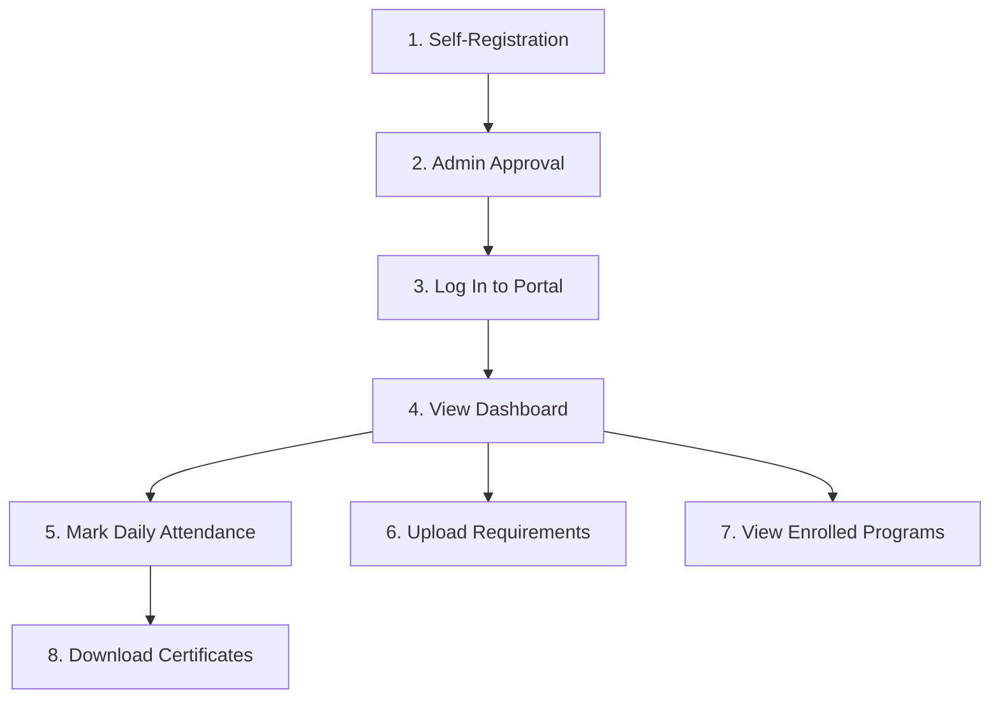
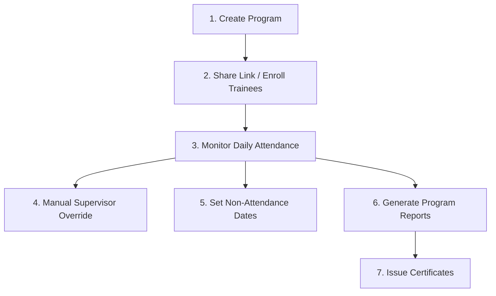
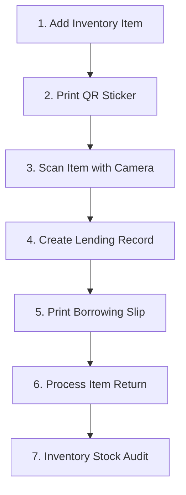
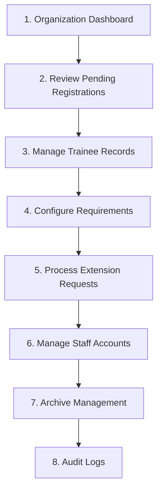

# BMDC 1.1 - User Manual
## Trainee Management & Attendance Tracking Platform

**Document Version:** 1.0  
**Release Date:** November 2026  
**Language Standard:** Simplified Technical English (ASD-STE100 principles)  
**Target Roles:** Trainees, Training Coordinators, Inventory Managers, Local Administrators

---

## Document overview and conventions

This manual gives step-by-step instructions for the BMDC 1.1 platform. It uses Simplified Technical English (STE) to make all procedures clear and easy to read.

### Typographical conventions

| Element | Format | Example |
|---|---|---|
| Buttons and links | Bold text | Click **Save**. |
| Menus and paths | Bold text with `>` | Select **Settings > Security**. |
| Data input fields | Bold label with code value | In the **Username** field, enter `user01`. |
| Screen and page names | Bold initial capital letters | On the **Trainee Dashboard** page... |
| System messages and code | Monospace code text | The message `Operation successful` appears. |
| Key combinations | Angle brackets with bold text | Press `<kbd>Ctrl</kbd> + <kbd>P</kbd>`. |

### Safety and alert notices

> [!WARNING]
> This notice identifies an action that can cause permanent data loss or security risk.

> [!CAUTION]
> This notice identifies an action that can cause a process error, incorrect record, or hardware issue.

> [!NOTE]
> This notice provides important context, tips, or operating rules.

---

# Section 1: System overview and quick start

## 1.1 Purpose of BMDC 1.1

BMDC 1.1 is a web-based trainee management and attendance platform. It serves local government units (LGUs) and training centers. It handles:
- Trainee registration and identity verification.
- Daily attendance tracking with camera photos and GPS coordinates.
- Training program scheduling and certificate generation.
- Equipment inventory tracking and QR-code lending slips.
- Administrative compliance and audit logging.

## 1.2 System requirements

Make sure your computer or mobile device meets these requirements:
- **Operating system:** Windows 10/11, macOS 12+, Ubuntu 20.04+, Android 10+, or iOS 15+.
- **Web browser:** Google Chrome 100+, Mozilla Firefox 100+, Microsoft Edge 100+, or Safari 15+.
- **Hardware:** Working camera for attendance selfies and QR scanning; GPS location sensor.
- **Network:** Broadband internet connection or mobile data.

## 1.3 Progressive Web App (PWA) and offline mode

BMDC 1.1 works as a Progressive Web App (PWA). You can install it on your device home screen or desktop.

### Install the application

1. Open the BMDC 1.1 website in your browser.
2. If the install prompt banner appears at the bottom of the screen, click **Install App**.
   The browser installs BMDC 1.1 as a standalone application.
3. If the banner does not appear, click the **Install** icon in the browser address bar.

### Understand offline operation

When your internet connection drops, the system displays an offline banner: `You are now offline. Changes will sync when reconnected.`
- You can still view cached trainee lists, inventory items, and programs.
- The system stores new local actions in the device database (IndexedDB).
- When the internet connection returns, the system syncs pending records automatically.

## 1.4 How to log in

Follow these steps to log into your account:

**Prerequisites:**
- You must have an active user account and internet connection.
- Open the BMDC 1.1 home page.

**Steps:**
1. Click **Sign In** in the top navigation bar.
   The **Login** window appears.
2. In the **Email / Username** field, enter your registered email address or username.
3. In the **Password** field, enter your account password.
4. From the **Organization / Tenant** drop-down menu, select your training center.
5. Click **Sign In**.

**Result:**
The system verifies your credentials. The home dashboard for your assigned role opens.

## 1.5 How to reset your password

Follow these steps if you forget your password:

1. Click **Sign In** in the top navigation bar.
2. Click the **Forgot password?** link below the password field.
3. In the **Email Address** field, enter your registered email.
4. Click **Send Reset Link**.
   The system sends a password reset email to your address.
5. Open your email inbox and click the link in the message.
6. In the **New Password** field, enter a password with at least 8 characters.
7. In the **Confirm Password** field, enter the exact same password.
8. Click **Update Password**.

**Result:**
The system saves your new password. You can now log in with the new password.

---

# Section 2: Chapter 1 — Trainee portal operations

This chapter explains all operations available to enrolled trainees.

## 2.1 Complete trainee self-registration

New applicants must complete the 8-step registration form.

**Prerequisites:**
- You must have a valid email address and digital copies of your requirements.
- Open the BMDC 1.1 home page.

**Steps:**
1. Click **Register Now** on the landing page.
   The **Registration** window opens at Step 1 (Account).
2. Complete **Step 1 (Account)**:
   - In the **Username** field, enter a unique username.
   - In the **Email** field, enter your active email address.
   - In the **Password** field, enter a strong password.
   - In the **Confirm Password** field, enter the same password again.
   - Click **Next**.
3. Complete **Step 2 (Personal Details)**:
   - Enter your **First Name**, **Last Name**, and **Middle Name** (if applicable).
   - In the **Phone** field, enter your mobile number.
   - From the **Sex** drop-down list, select your gender.
   - In the **Birth Date** field, select your date of birth.
   - In the **Birth Place** field, enter your municipality of birth.
   - From the **Civil Status** drop-down list, select your status.
   - Click **Next**.
4. Complete **Step 3 (Address)**:
   - In the **Province** field, enter your province.
   - In the **Municipality** field, enter your city or municipality.
   - In the **Barangay** field, enter your barangay.
   - In the **Street** field, enter your house number and street name.
   - Click **Next**.
5. Complete **Step 4 (Background)**:
   - From the **Educational Attainment** list, select your highest education level.
   - From the **Employment Status** list, select your employment status.
   - Click **Next**.
6. Complete **Step 5 (Tenant Selection)**:
   - From the **Organization** drop-down list, select your target training center.
   - Click **Next**.
7. Complete **Step 6 (Requirements)**:
   - Drag your digital documents into the **Requirement Drop Zone**, or click **Browse Files**.
   - Make sure each file is in PDF, PNG, or JPG format and under 10 megabytes.
   - Click **Next**.
8. Complete **Step 7 (Program Selection)**:
   - Click the card of the training program you want to join.
   - Click **Next**.
9. Complete **Step 8 (Email Verification)**:
   - Check your email inbox for a 6-digit one-time password (OTP).
   - Enter the 6 digits into the **Verification Code** boxes.
   - Click **Complete Registration**.

**Result:**
The system records your registration. The status becomes `Pending Admin Approval`. You receive a confirmation email.

## 2.2 Navigating the Trainee Dashboard

After login, the system opens `/trainee/dashboard`. The dashboard contains these panels:
- **Attendance rate card:** Displays your total attendance percentage.
- **Active program card:** Displays your current course, instructor name, and schedule.
- **Upcoming sessions:** Lists the next training dates and times.
- **Requirements status:** Shows pending and approved document submissions.
- **Notifications panel:** Displays center announcements and overdue warnings.

## 2.3 Enrolling in a program via sharing link

When a coordinator sends you a program link, follow these steps:

1. Click the link sent by your coordinator (`/share?token=...`).
   The **Program Enrollment** page opens.
2. If you are not logged in, enter your credentials in the login prompt.
3. Review the program schedule, venue, and required documents.
4. Click **Confirm Enrollment**.

**Result:**
The system submits your enrollment. The program appears under **My Programs** on your dashboard.

## 2.4 Marking daily attendance

Trainees must mark daily attendance during designated Time-In and Time-Out windows.

> [!CAUTION]
> Do not use a proxy or virtual private network (VPN). The system records your GPS coordinates. If you use a VPN, the system marks your location invalid.

**Prerequisites:**
- You must have an active camera and GPS location enabled on your device.
- Log into the trainee portal and open **Attendance** from the navigation bar.

**Steps:**
1. Check the **Attendance Window** status banner.
   Make sure the banner shows `Window Open`.
2. Click **Mark Attendance** (or **Time In** / **Time Out**).
   The **Camera Modal** opens.
3. If the browser asks for camera and location permissions, click **Allow**.
   The camera live preview appears.
4. Look straight into the camera lens. Make sure your face is well-lit and inside the frame.
5. Click **Capture Photo**.
   The system freezes the photo preview.
6. Review your photo. If the image is blurry, click **Retake**.
7. Click **Submit Attendance**.

**Result:**
The system uploads your photo and location. A green confirmation badge displays your exact time and records your status as `Present` (or `Late` if submitted after the cutoff time).

## 2.5 Reviewing attendance history

Follow these steps to check your past attendance records:

1. Click **Attendance** in the trainee navigation menu.
2. Use the **Previous Month** and **Next Month** arrows to navigate the calendar.
3. Review the colored status dots:
   - **Green dot:** Present.
   - **Yellow dot:** Late.
   - **Red dot:** Absent.
   - **Blue dot:** Excused absence.
4. Click any date on the calendar.
   The **Attendance Details** card opens. It shows your Time-In photo, timestamp, Time-Out photo, and supervisor remarks.

## 2.6 Submitting additional training requirements

Follow these steps if your coordinator asks for updated documents:

1. Click **Requirements** in the top navigation bar.
   The list of required items appears.
2. Find the requirement with status `Pending` or `Rejected`.
3. Click **Upload File**.
4. Select your file from your computer or phone.
5. Click **Submit Document**.

**Result:**
The status changes to `Submitted`. Your training coordinator will review the file.

## 2.7 Viewing and downloading certificates

Follow these steps when you complete a training program:

1. Click **My Programs** in the navigation menu.
2. Select the completed program card.
3. Click **View Certificate**.
   The certificate viewer opens and displays your digital certificate with a verification QR code.
4. Click **Download PDF** to save the certificate to your device.
5. Click **Print Certificate** to send the document directly to a printer.

---

# Section 3: Chapter 2 — Staff training coordinator operations

This chapter explains all operations available to Training Coordinators.

## 3.1 Creating a new training program

Follow these steps to set up a new training course:

**Prerequisites:**
- Log into the coordinator portal and navigate to `/programs`.

**Steps:**
1. Click **Create Program** in the top right corner.
   The **Program Form** page opens.
2. In the **Program Name** field, enter the full course title.
3. In the **Program Code** field, enter an identifier (for example, `WLD-2026-01`).
4. In the **Description** field, enter course objectives and syllabus notes.
5. In the **Start Date** and **End Date** fields, select the training period.
6. In the **Max Trainees** field, enter the maximum class capacity.
7. Under **Attendance Windows**, enter the official **Time-In Start**, **Time-In End**, and **Tardy Cutoff** times.
8. Click **Save Program**.

**Result:**
The system saves the program. It appears with status `Active` in the program catalog.

## 3.2 Generating program share links

Follow these steps to invite trainees to enroll directly:

1. Click **Programs** in the main navigation menu.
2. Find the target program and click **View Details**.
3. In the program header, click **Generate Link**.
   The system generates a secure link with an authorization token.
4. Click **Copy Link**.
   The link copies to your clipboard.
5. Send this link to applicants by email, messaging app, or posting on your notice board.

## 3.3 Managing program trainee rosters

Follow these steps to manage trainees inside a course:

1. Open **Programs** and select your active course.
2. Click the **Enrolled Trainees** tab.
   The trainee roster table appears.
3. To change a trainee status, click the **Actions** button (three dots) next to their name.
4. Select one of these statuses:
   - **Active:** Trainee attends classes normally.
   - **Completed:** Trainee finished all program hours and requirements.
   - **Dropped:** Trainee discontinued participation.
5. Click **Confirm Status Update**.

## 3.4 Monitoring and overriding daily attendance

Coordinators can view real-time class attendance and manually correct mistakes.

> [!NOTE]
> Use manual attendance override only when a trainee experiences hardware failure, phone battery loss, or an approved official excuse.

**Steps:**
1. Click **Attendance** from the coordinator menu.
2. From the program selector, choose your active program.
3. Select today's date on the date picker.
   The trainee attendance grid displays real-time check-ins.
4. To override an attendance entry:
   - Find the trainee row.
   - Click **Edit Attendance**.
   - Change the status to `Present`, `Late`, or `Excused`.
   - In the **Supervisor Notes** field, enter the reason for the override.
   - Click **Save Override**.

**Result:**
The system updates the trainee record and logs your user ID in the audit trail.

## 3.5 Configuring non-attendance dates

Add holidays and suspension days so the system does not mark trainees absent.

1. Navigate to `/non-attendance-dates` from the navigation menu.
2. Click **Add Non-Attendance Date**.
3. In the **Date** field, choose the holiday or suspension date.
4. In the **Reason** field, enter the description (for example, `National Holiday` or `Typhoon Suspension`).
5. Select whether this date applies to all programs or one specific program.
6. Click **Save Date**.

**Result:**
The calendar marks this day exempt. The system skips daily attendance calculations for this date.

## 3.6 Generating and exporting reports

Follow these steps to export training records:

1. Click **Reports** in the main navigation menu.
2. Select the report type:
   - **Attendance Summary Report:** Monthly attendance totals and percentages.
   - **Trainee Performance Report:** Completion rates and hours accumulated.
   - **Program Evaluation Report:** Total enrollment and dropout statistics.
3. Select the target **Program** and **Date Range**.
4. Click **Generate Report**.
   A preview appears on screen.
5. Click **Export to Excel** or **Export to PDF**.

**Result:**
Your browser downloads the formatted report file.

---

# Section 4: Chapter 3 — Staff inventory manager operations

This chapter explains how to manage training tools, equipment, materials, and lending records.

## 4.1 Adding a new inventory item

Follow these steps to register equipment in the catalog:

**Prerequisites:**
- Log into the staff portal and navigate to `/items`.

**Steps:**
1. Click **Add New Item** in the top right corner.
   The **Item Form** opens.
2. In the **Item Name** field, enter the equipment name (for example, `Digital Multimeter`).
3. In the **Category** drop-down list, select the category (Tools, Machines, Consumables, Safety Gear).
4. In the **Serial Number / SKU** field, enter the manufacturer serial number or tag.
5. In the **Total Quantity** field, enter the physical count.
6. In the **Low Stock Threshold** field, enter the minimum count that triggers a low-stock alert.
7. In the **Storage Location** field, enter the shelf or cabinet number.
8. Click **Save Item**.

**Result:**
The item appears in the inventory catalog. The system assigns a unique inventory ID.

## 4.2 Generating and printing QR codes

Every physical item must have a printed QR code attached to its body.

1. Open `/items` and locate your item in the list.
2. Click the **QR Code** icon next to the item name.
   The **QR Code Modal** opens.
3. Check that the item name and serial number match the physical tool.
4. Click **Print Label**.
5. Set your label printer settings:
   - Paper size: Standard sticker / label.
   - Scale: Fit to printable area.
6. Click **Print**.
7. Attach the adhesive QR sticker to the physical tool or storage container.

## 4.3 Scanning equipment with the camera scanner

The system includes a camera scanner for rapid equipment check-out and inspection.

> [!NOTE]
> Make sure your camera lens is clean. Ensure adequate lighting on the QR code label.

**Steps:**
1. Navigate to `/scan` from the navigation menu.
   The **QR Scanner Overlay** opens.
2. Point your camera at the QR code sticker on the item.
3. Hold the camera steady at a distance of 15 to 25 centimeters.
   The scanner detects the code and sounds a confirmation beep.
4. The **Item Summary Card** appears on screen. It displays:
   - Item name and serial code.
   - Current status (Available, Lent, Maintenance).
   - Quantity currently available in stock.
5. Choose your action:
   - Click **Borrow Item** to open the lending form.
   - Click **Return Item** to process a return.
   - Click **Close** to scan another code.

## 4.4 Processing item borrowing (lending)

Follow these steps to lend equipment to a trainee or staff member:

**Steps:**
1. Navigate to `/lendings`.
2. Click **New Lending Record**.
   The **Add Lending Modal** opens.
3. In the **Borrower Type** selector, choose `Trainee` or `Staff`.
4. In the **Borrower Name** search box, enter the trainee name or ID number, then select the record from the list.
5. In the **Item** search box, select the equipment (or scan its QR code).
6. In the **Quantity** field, enter the number of units borrowed.
7. In the **Expected Return Date** field, select the deadline date and time.
8. In the **Notes** field, write any pre-existing tool marks or scratches.
9. Click **Submit Lending**.

**Result:**
The system decreases available stock by the borrowed count. A new record appears under the **Borrowed** tab.

## 4.5 Printing the borrowing slip

Every lending transaction requires a signed physical borrowing slip.

> [!CAUTION]
> Always give the equipment to the borrower only *after* they sign the printed borrowing slip.

**Steps:**
1. Immediately after submitting the lending record, click **Print Borrowing Slip** in the success dialog.
   (Or go to `/lendings`, locate the transaction, and click **Print Slip**).
   The **Print Slip Page** opens (`/lendings/:id/slip`).
2. Review the printed slip data:
   - Transaction ID and timestamp.
   - Borrower full name and contact number.
   - Equipment name, serial number, and quantity.
   - Expected return date and terms of liability.
3. Press `<kbd>Ctrl</kbd> + <kbd>P</kbd>` (or click **Print Slip**).
4. Hand the printed slip to the borrower.
5. Have the borrower sign the **Borrower Signature** line.
6. File the signed copy in your lending binder.

## 4.6 Processing item returns

Follow these steps when a borrower returns equipment:

1. Open `/lendings` and click the **Borrowed** tab.
2. Locate the transaction (or scan the item QR code at `/scan`).
3. Click **Mark as Returned**.
   The **Return Confirmation** window opens.
4. Inspect the physical tool:
   - Check for damage, missing parts, or excessive wear.
5. Select the **Returned Condition**:
   - `Good`: Tool is fully operational.
   - `Damaged`: Tool requires repair or replacement.
   - `Lost`: Tool was not returned.
6. In the **Actual Return Date** field, confirm today's date.
7. Click **Confirm Return**.

**Result:**
The transaction moves to the **Returned** tab. The system returns the item quantity to active inventory stock.

## 4.7 Managing overdue equipment alerts

When an item is not returned by the expected date, the system marks it `Overdue`.
- The top navigation bar displays a red bell badge with the count of overdue tools.
- Click the **Overdue Notification Bell** to open the list of overdue borrowers.
- Click **Send Reminder** to dispatch an automated email reminder to the borrower.
- Click **Export Overdue List** to create an escalation report for administration.

---

# Section 5: Chapter 4 — Local administrator operations

This chapter explains administrative functions for managing centers, staff, trainees, requirements, and compliance.

## 5.1 Reviewing and approving trainee registrations

Local Administrators must verify new applicant records before applicants can log in.

**Prerequisites:**
- Log into your Local Admin account and open `/registrations`.

**Steps:**
1. Click the **Pending** tab at the top of the registrations table.
   The list of pending applicants appears.
2. Click **Review** on the applicant row.
   The **Applicant Details Dialog** opens.
3. Verify the applicant data:
   - Full legal name and birth date.
   - Address and contact telephone number.
   - Organization and requested training program.
4. Click the **Requirements** tab to view uploaded documents.
   Click each thumbnail to inspect document authenticity.
5. Take one of these actions:
   - **To approve:** Click **Approve Registration**. The system creates an active trainee account and dispatches a welcome email.
   - **To reject:** Click **Reject Registration**. Enter the exact reason in the **Rejection Notes** field (for example, `Uploaded ID photo is unreadable`), then click **Confirm Rejection**.

**Result:**
The system removes the applicant from the pending queue and sends an automated notification email to the applicant.

## 5.2 Managing trainee records and bulk import

Administrators can edit trainee profiles, deactivate accounts, or import rosters in bulk.

### Bulk import trainees from CSV

> [!WARNING]
> Make sure your CSV file follows the exact column headers specified in the template. An invalid column header will stop the import process.

1. Navigate to `/trainees`.
2. Click **Import CSV** in the upper toolbar.
3. Click **Download Template** to download the standard CSV structure.
4. Populate your spreadsheet with trainee rows (`first_name`, `last_name`, `email`, `phone`, `birth_date`, `sex`, `province`, `municipality`).
5. Drag your completed CSV file into the upload box.
6. Click **Validate and Import**.

**Result:**
The system validates every row, creates trainee profiles, and displays an import summary card.

## 5.3 Configuring training requirement definitions

Create mandatory document rules that trainees must submit during registration or enrollment.

1. Navigate to `/admin/requirements` from the navigation menu.
2. Click **Create Requirement Definition**.
   The **Requirement Definition Form** opens (`/admin/requirements/new`).
3. In the **Requirement Title** field, enter the name (for example, `Medical Clearance Certificate`).
4. In the **Description** field, enter instructions for the applicant.
5. In the **Applicable Program** list, choose whether this requirement applies to all programs or specific courses.
6. In the **File Types** checklist, select allowed extensions (`PDF`, `PNG`, `JPG`).
7. In the **Max File Size** field, enter the limit in megabytes (default is `10`).
8. Select the **Mandatory** checkbox if enrollment cannot proceed without this file.
9. Click **Save Definition**.

**Result:**
The system activates the requirement. The item appears in trainee registration and profile forms.

## 5.4 Processing trainee extension requests

Trainees who cannot finish course hours due to medical or official reasons can submit extension requests.

1. Navigate to `/extension-requests` from the navigation menu.
2. Click the **Pending Requests** tab.
3. Select an extension request row.
4. Review the trainee reason, attached medical or clearance files, and requested number of extension days.
5. Click **Approve Request** or **Decline Request**.
6. If approving, enter the new authorized completion date.
7. Click **Confirm Decision**.

**Result:**
The system extends the trainee enrollment period and adjusts their attendance deadline.

## 5.5 Managing staff accounts

Create and manage credentials for Training Coordinators and Inventory Managers.

> [!CAUTION]
> Never share administrator passwords. Create separate staff accounts for each employee.

**Steps:**
1. Navigate to `/account-management` from the navigation menu.
2. Click **Add Staff User**.
   The **User Account Form** opens.
3. In the **Full Name** field, enter the staff member name.
4. In the **Email** field, enter their official organizational email address.
5. In the **Role** drop-down menu, select the appropriate role:
   - `staff_training_coordinator`: Manages programs, rosters, and attendance.
   - `staff_inventory_manager`: Manages tools, scanning, and lending records.
6. In the **Temporary Password** field, enter a temporary password.
7. Check the **Require password change on first login** box.
8. Click **Create Account**.

**Result:**
The system saves the user account. The staff member receives an invitation email with login instructions.

## 5.6 Managing the system archive and data restoration

BMDC 1.1 uses soft-delete protection. Deleted trainees, programs, and equipment move to the archive before permanent disposal.

1. Navigate to `/admin/archive` from the navigation menu.
2. Select the entity type tab:
   - **Trainees**
   - **Programs**
   - **Equipment**
   - **Requirement Files**
3. Review the **Days Remaining** counter for each item (items purge automatically after the 90-day retention period).
4. To restore an accidentally deleted item:
   - Locate the item row.
   - Click the **Restore** button (counter-clockwise arrow icon).
   - In the confirmation dialog, click **Confirm Restoration**.
5. To permanently delete an item before 90 days:
   - Click the **Delete Permanently** icon (trash can).
   - Type `DELETE` into the confirmation input box.
   - Click **Purge Forever**.

**Result:**
Restored items return to active tables immediately. Purged items are removed permanently from the database.

## 5.7 Reviewing security and activity logs

Administrators must regularly audit system actions for compliance and security.

1. Navigate to `/activity-logs` from the navigation menu.
2. Use the search filters to narrow events:
   - **Filter by User:** Enter a staff username or email.
   - **Filter by Action Type:** `LOGIN`, `UPDATE`, `DELETE`, `ATTENDANCE_OVERRIDE`, `LENDING_CREATE`.
   - **Filter by Date Range:** Select start and end dates.
3. Click any log row to expand the full event details.
4. Inspect the **Client IP Address**, **User Agent / Device**, and **Old vs. New Data Values**.
5. Click **Export Audit Log (CSV)** to save an offline compliance record.

---

# Section 6: Consolidated troubleshooting and error matrix

Use this troubleshooting matrix to resolve common operational issues.

| Error Message or Symptom | Probable Cause | Corrective Action in STE |
|---|---|---|
| `Camera access denied` | Browser does not have permission to access your webcam. | 1. Click the **Padlock** icon next to the browser URL. 2. Set **Camera** to **Allow**. 3. Refresh the web page. |
| `GPS location unavailable` | Device location services are turned off or blocked. | 1. Turn on location services in device settings. 2. Set browser location permission to **Allow**. 3. Stand near an open window or outdoor area. 4. Retry attendance submission. |
| `Attendance window closed` | You are trying to mark attendance outside official hours. | 1. Check your program session start and end times. 2. Submit attendance only during the designated window. 3. If late for an emergency, contact your Training Coordinator for an override. |
| `QR scanner cannot read code` | Poor room lighting, camera blur, or dirty sticker. | 1. Wipe the camera lens with a microfiber cloth. 2. Increase ambient lighting on the equipment. 3. Hold the camera 20 centimeters from the sticker. 4. If sticker is torn, print a replacement from `/items`. |
| `File upload rejected: Size too large` | Upload file exceeds the 10 MB maximum limit. | 1. Open your image or PDF file in an image editor. 2. Compress the document resolution. 3. Make sure the file is under 10 megabytes. 4. Upload the file again. |
| `File upload rejected: Format invalid` | File extension is not an approved format. | 1. Convert your document to standard `PDF`, `PNG`, or `JPG`. 2. Do not upload `.exe`, `.zip`, or word processor formats. 3. Upload the converted file. |
| `Session expired / Invalid token` | You stayed inactive for more than 2 hours. | 1. Click **OK** on the expiration dialog. 2. Enter your username and password on the login screen. 3. Select your organization. 4. Click **Sign In**. |
| `Offline: Changes pending sync` | Internet connection was lost during operation. | 1. Check your Wi-Fi router or mobile data. 2. Keep the BMDC 1.1 browser tab open. 3. When internet returns, wait for the green `Connection restored` alert. |
| `Item out of stock for lending` | All physical units are currently borrowed. | 1. Open `/lendings` and check the **Borrowed** tab. 2. Identify which borrower holds the tool. 3. Process the return of available units before lending again. |
| `Account pending approval` | Administrator has not yet verified your registration. | 1. Contact your training center administrator. 2. Confirm that you completed email verification. 3. Wait for the administrator verification email. |

---

# Section 7: Glossary of terms and technical support

## 7.1 Glossary of terms

- **ASD-STE100:** Aerospace and Defence Industries Association of Europe - Simplified Technical English. An international specification for writing clear technical documentation.
- **BMDC:** Center name (Barangay / Municipal Development Center).
- **LGU:** Local Government Unit.
- **OTP:** One-Time Password. A 6-digit verification code sent by email.
- **PWA:** Progressive Web App. Web software that can be installed on your device and works offline.
- **QR Code:** Quick Response Code. A machine-readable 2D barcode for fast tool identification.
- **RBAC:** Role-Based Access Control. Security method that restricts features according to your assigned user role.
- **Tenant:** An isolated organization or training center branch within the BMDC multi-tenant database.

## 7.2 Technical support contact channels

If you cannot solve an issue using the troubleshooting matrix, contact technical support:

- **Help Desk Portal:** `https://support.bmdc.gov.ph`
- **Technical Support Email:** `support@bmdc.gov.ph`
- **Emergency Hotline:** `(02) 8888-BMDC` (Monday to Friday, 8:00 AM - 5:00 PM)
- **Local Center Office:** Contact your assigned LGU Training Administrator directly.
